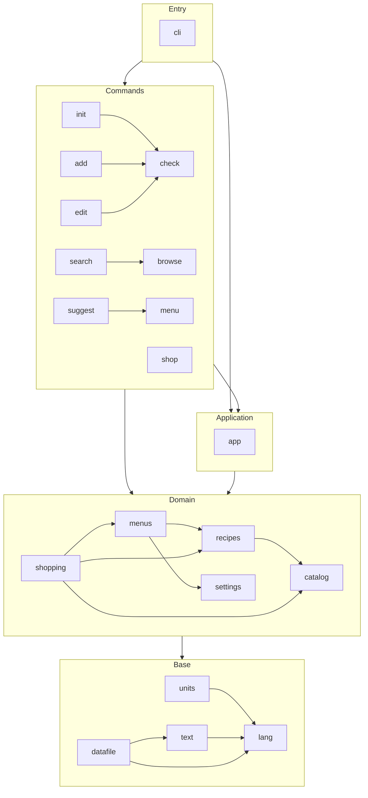

# recipe-menu architecture

This document covers what crosses features: the stack, the modules and the directions in which they may depend on each other, the data model, errors, output, and tests. Each feature's interfaces go in that feature's design and follow these rules. The decision records in `docs/adr/` give the reasons.

## 1. Context and constraints

- **Windows first, Linux in CI.** The tool runs on Troy's Windows 11 PC in Windows Terminal, under Windows PowerShell 5.1 and PowerShell 7. CI also runs the tests on Linux ([requirements 7](requirements.md#7-non-functional-requirements)). So code and tests build every path with `pathlib`, and the same tests pass on both systems.
- **One command on the PATH.** `recipe-menu` runs from any folder in PowerShell ([requirements 7](requirements.md#7-non-functional-requirements)). Troy installs it with `uv tool install` (ADR-0006).
- **Chinese text.** Data files are UTF-8, with or without a byte order mark. Chinese shows correctly in Windows Terminal with no change to a Windows setting, and a Chinese character takes two columns in an aligned table ([requirements 7](requirements.md#7-non-functional-requirements), ADR-0004).
- **No network.** The tool never uses the network ([requirements 7](requirements.md#7-non-functional-requirements)). No module imports a network library, and nothing in the stack needs one at run time.
- **Data outside the code.** The data folder is `~/recipe-menu`, or the folder that `--data` or `RECIPE_MENU_DATA` names ([requirements 3](requirements.md#3-how-users-interact-with-it)). The repository holds only the example data that the tests use and the files that `init` writes.
- **Your files stay as you wrote them.** `init` and `menu new` create a file only where none exists. `shop` replaces only its own week's file in `shopping/`. No other v0.1 command writes a file ([requirements 3](requirements.md#3-how-users-interact-with-it)).
- **Every message in two languages.** Every message, table heading, unit name, day name, and meal name exists in English and in Chinese and follows the chosen language ([requirements 3](requirements.md#3-how-users-interact-with-it) and [7](requirements.md#7-non-functional-requirements), ADR-0004).
- **The place of each mistake.** A message about a data file names the file and the place in it: the line for a syntax mistake, and the field, such as "ingredient 3" or "Monday dinner", for a wrong value ([requirements 3](requirements.md#3-how-users-interact-with-it)).
- **Exit codes.** A command exits with 0 when it worked, 1 when the data has an error or a file is missing, and 2 when the command line is wrong ([requirements 3](requirements.md#3-how-users-interact-with-it)).
- **Size and speed.** The tool handles 1,000 recipes, 300 catalog ingredients, and 52 week menus, and `check`, `list`, `show`, `search`, `menu show`, and `shop` each finish within 1 second on Troy's PC (PT01, [requirements 7.1](requirements.md#71-performance-targets)). Section 8 limits what each command reads, and ADR-0002 weighs the cost of parsing.

## 2. Tech stack

| Part | Choice | Why |
| --- | --- | --- |
| Language | Python 3.13 or newer, with only the standard library at run time (ADR-0001). | Troy's Python pack runs it on Windows and in CI. The standard library reads TOML, knows ISO weeks, computes with exact fractions, and gives character widths, so the tool needs no third-party package. |
| Data files | TOML 1.0, in the layout of `docs/prototypes/example-data.md`, read with `tomllib` (ADR-0002). | TOML has comments and Unicode strings, and indentation means nothing in it, so Troy can edit it in Notepad. `tomllib` gives the line of a syntax mistake. |
| Writing files | Text that the code builds from templates, written through `datafile`. | `init`, `menu new`, and `shop` write whole new files, so they need no TOML writer. |
| Command line | A small parser in `cli`, not `argparse` (ADR-0005). | The help and every error must exist in both languages. `argparse` writes its own English messages. |
| Amounts | `fractions.Fraction` (ADR-0007). | Scaling by servings and rounding up stay exact. 300 g for 3 servings of a 2-serving recipe is 450 g, never 450.00000001 g that rounds up to 451 g. |
| Weeks and dates | `datetime.date.isocalendar` and `datetime.date.fromisocalendar`. | ISO weeks such as `2026-W47` come from the standard library. |
| Character widths | `unicodedata.east_asian_width`. | Wide and fullwidth characters take two columns, and every other character takes one (ADR-0004). |
| Environment | The Python pack's mamba environment, with uv installing `requirements-dev.lock`. | troy-mode's rule for Python projects. No `.venv` folder. |
| Build | hatchling, the package `src/recipe_menu`, and the console script `recipe-menu = "recipe_menu.cli:main"` in `pyproject.toml`. | The pack's build backend. F05 adds the console script. |
| Installation | `uv tool install` from a release tag (ADR-0006). | uv is in the pack's environment. The tool gets its own environment, so work on a branch never changes the installed command. |
| Checks | ruff, mypy in strict mode, pytest, and coverage.py, with the pack's settings. | The pack's CI job runs them. troy-check checks R04 to R07 on the code itself and reads the test and coverage reports for R09 to R11. |

## 3. Modules

The package is `recipe_menu` in `src/recipe_menu/`. Each module is a folder, and its `__init__.py` is the only file that other modules import. The rows run from the base modules up to `cli`. Each row names the features that build the module.

| Module | Owns | External interfaces | May depend on |
| --- | --- | --- | --- |
| lang | `src/recipe_menu/lang/**`. Built by F01 and F02. The language type, and text in two languages with its fallback to the other language. | `src/recipe_menu/lang/__init__.py` | None |
| units | `src/recipe_menu/units/**`. Built by F01. Units and quantities: reads them in either language, converts, scales, adds, and writes them. | `src/recipe_menu/units/__init__.py` | lang |
| text | `src/recipe_menu/text/**`. Built by F02. The message type and the shared messages, the language choice, English plurals and lists, display width, aligned tables, and the console streams. | `src/recipe_menu/text/__init__.py` | lang |
| datafile | `src/recipe_menu/datafile/**`. Created by F03. Later features add the writes they need. The paths of the data folder's files, reading a TOML file, writing a file, and problems with their places. | `src/recipe_menu/datafile/__init__.py` | lang, text |
| catalog | `src/recipe_menu/catalog/**`. Built by F03. Reads the catalog and the pantry, finds ingredients and tags by name in either language, and reports their problems. | `src/recipe_menu/catalog/__init__.py` | lang, units, text, datafile |
| recipes | `src/recipe_menu/recipes/**`. Built by F04. Lists the recipe IDs, reads recipe files, and reports their problems. | `src/recipe_menu/recipes/__init__.py` | lang, units, text, datafile, catalog |
| settings | `src/recipe_menu/settings/**`. Built by F05. Reads the settings file: the language, the meals, and the default servings. F14 and F16 add their settings in v0.2. | `src/recipe_menu/settings/__init__.py` | lang, text, datafile |
| menus | `src/recipe_menu/menus/**`. Built by F06. ISO weeks, this week and next week, dates and day names in both languages, and reading week menu files with their problems. | `src/recipe_menu/menus/__init__.py` | lang, text, datafile, settings, recipes |
| shopping | `src/recipe_menu/shopping/**`. Built by F12. Builds the shopping list from a week menu, its recipes, the catalog, and the pantry. Reads no file. | `src/recipe_menu/shopping/__init__.py` | lang, units, catalog, recipes, menus |
| app | `src/recipe_menu/app/**`. Built by F05. The values that connect cli with the commands: the context, the command description, and the usage error. | `src/recipe_menu/app/__init__.py` | lang, text, datafile, settings |
| check | `src/recipe_menu/commands/check/**`. Built by F07. The check command. add and edit reuse it to check one recipe. | `src/recipe_menu/commands/check/__init__.py` | app, lang, units, text, datafile, catalog, recipes, settings, menus, shopping |
| init | `src/recipe_menu/commands/init/**`. Built by F08. The init command and the example files that it writes. | `src/recipe_menu/commands/init/__init__.py` | app, lang, units, text, datafile, catalog, recipes, settings, menus, shopping, check |
| browse | `src/recipe_menu/commands/browse/**`. Built by F09. The list and show commands. | `src/recipe_menu/commands/browse/__init__.py` | app, lang, units, text, datafile, catalog, recipes, settings, menus, shopping |
| search | `src/recipe_menu/commands/search/**`. Built by F10. The search command. | `src/recipe_menu/commands/search/__init__.py` | app, lang, units, text, datafile, catalog, recipes, settings, menus, shopping, browse |
| menu | `src/recipe_menu/commands/menu/**`. Built by F11. The menu new and menu show commands. | `src/recipe_menu/commands/menu/__init__.py` | app, lang, units, text, datafile, catalog, recipes, settings, menus, shopping |
| shop | `src/recipe_menu/commands/shop/**`. Built by F13. The shop command: the list in the terminal and the Markdown checklist. | `src/recipe_menu/commands/shop/__init__.py` | app, lang, units, text, datafile, catalog, recipes, settings, menus, shopping |
| suggest | `src/recipe_menu/commands/suggest/**`. Built by F14 in v0.2. The menu suggest command. | `src/recipe_menu/commands/suggest/__init__.py` | app, lang, units, text, datafile, catalog, recipes, settings, menus, shopping, menu |
| add | `src/recipe_menu/commands/add/**`. Built by F15 in v0.2. The add command. | `src/recipe_menu/commands/add/__init__.py` | app, lang, units, text, datafile, catalog, recipes, settings, menus, shopping, check |
| edit | `src/recipe_menu/commands/edit/**`. Built by F16 in v0.2. The edit command. | `src/recipe_menu/commands/edit/__init__.py` | app, lang, units, text, datafile, catalog, recipes, settings, menus, shopping, check |
| cli | `src/recipe_menu/cli/**`, `src/recipe_menu/__init__.py`, `src/recipe_menu/__main__.py`, `src/recipe_menu/commands/__init__.py`. Built by F05. The entry point: the command-line parser, the help and the version, where the data folder is, the language choice at start, running a command, and the exit codes. | `src/recipe_menu/cli/__init__.py` | lang, text, datafile, settings, app, check, init, browse, search, menu, shop, suggest, add, edit |

## 4. Dependency rules

An arrow points from a module to a module that it may depend on. The diagram shows the five layers and the arrows inside a layer. The table in section 3 is the exact list, and troy-check reads it for R07.

- A module depends only on modules in lower layers and on the modules of its own layer that an arrow names. Nothing depends on a module in a higher layer, and no module depends on `cli`.
- A module imports another module only as `recipe_menu.<module>` or `recipe_menu.commands.<module>`, which is that module's `__init__.py`. Inside its own folder, a module imports its files directly and never its own `__init__.py`.
- Base and domain modules never print, never read the command line or the environment, and never exit. Only `cli` touches the outside world (section 8).
- `shopping` reads no file. It turns values that other modules loaded into the shopping list, so F12's tests need no files.
- `units` does not use `text`, because F01 comes before F02. It reports a wrong quantity as a value that says what is wrong, and `catalog` and `recipes` turn that value into a message.
- Two dependencies come from shared modules, not from the requirements' graph. F01 creates `lang`, and F02 uses it. F03 creates `datafile`, and F05 uses it. Both point to an earlier feature, as the design checklist requires.
- A command feature adds its command to the list of commands in `cli` in its mock PR, so that its tests can run it through `recipe_menu.cli.main`. That entry is the only change a command feature makes in `cli`.

## 5. Data model

The values below cross module boundaries. Each one is an immutable dataclass or an enum. The interface designs give the exact names and signatures. A raw TOML table never leaves the module that reads its file.

### 5.1 Data files

The keys and shapes of every file are those of `docs/prototypes/example-data.md`. F03 to F06 list the checks on each key in their designs. Files are read as UTF-8, with or without a byte order mark. The tool writes UTF-8 without a byte order mark, with LF line ends.

| File | What it holds | Read by | Written by |
| --- | --- | --- | --- |
| `settings.toml` | `language`, `meals`, and `servings`. In v0.2, F14 adds the dishes per meal and F16 adds the editor. | settings | init |
| `catalog.toml` | `categories`, `ingredients`, and `tags`, in shopping order. | catalog | init |
| `pantry.toml` | `pantry`, a list of ingredient names. | catalog | init |
| `recipes/<id>.toml` | `name`, `servings`, `tags`, `ingredients`, and `steps`. | recipes | init writes `tomato-egg.toml`. In v0.2, add writes new recipes. |
| `menus/<week>.toml` | `week`, then one table per day with one list of dishes per meal. | menus | menu new writes an empty week. In v0.2, menu suggest fills empty meals. |
| `shopping/<week>.md` | The Markdown checklist of one week. | No module | shop |

`<id>` is the recipe ID, and `<week>` is an ISO week such as `2026-W47`.

### 5.2 Values

| Value | Module | Fields | Notes |
| --- | --- | --- | --- |
| `Lang` | lang | `EN` with the value "en", and `ZH` with the value "zh". | A `StrEnum`. Its values are what `--lang` and the settings' `language` take. F01 creates it. |
| `BiText` | lang | `en: str or None` and `zh: str or None`, with at least one of them set. | Gives the asked language, or the other one when the asked one is missing. Names and notes use it. F02 adds it. |
| `Unit` | units | Its kind (mass, volume, or count), its size in g or ml for mass and volume, and its names in both languages. | One member for each unit in requirements 3. |
| `Quantity` | units | An exact `amount: Fraction` with a `Unit`, or "to taste". | Mass converts to grams and volume to millilitres. A count unit converts to nothing else. |
| `Message` | text | An English and a Chinese template with the same `{name}` placeholders. | Every text the tool shows that is not data. Creating a message without both languages, or with different placeholders, fails. |
| `DataFolder` | datafile | Its root folder and the path of each file in 5.1. | The only place that knows the file names. |
| `Problem` | datafile | `severity` (error or warning), `file` (the path relative to the data folder), `place` (the line or the field, in both languages), and `message` (a `Message` with its values). | Readers return problems. They never raise them. |
| `Category` | catalog | `key: str` and `name: BiText`. | The file's order is the shopping order. |
| `Ingredient` | catalog | `name: BiText` with both languages, `category: Category`, and `unit: Unit or None`, the default unit. | Names are unique in both languages. Recipes and the pantry refer to the same `Ingredient` value, so the shopping list merges ingredients by identity. |
| `Tag` | catalog | `name: BiText` with both languages. | |
| `Catalog` | catalog | The categories, the ingredients, and the tags, in file order. | Finds an ingredient or a tag by its name in either language. |
| `Pantry` | catalog | A set of `Ingredient` values. | |
| `Recipe` | recipes | `id: str`, `name: BiText`, `servings: int` (1 or more), `tags: tuple[Tag, ...]`, `ingredients: tuple[RecipeIngredient, ...]`, and the steps as a tuple of strings for each language. | The ID is the file name without `.toml`. IDs compare exactly as written, so Windows and Linux give the same result. |
| `RecipeIngredient` | recipes | `ingredient: Ingredient`, `quantity: Quantity`, and `note: BiText or None`. | The reader gives a quantity without a unit the ingredient's default unit. |
| `Meal` | settings | `BREAKFAST`, `LUNCH`, and `DINNER`, in this order, with their names in both languages. | A `StrEnum`, with the values that the files use. |
| `Settings` | settings | `language: Lang or None`, `meals: tuple[Meal, ...]`, and `servings: int`. | Defaults: no language, lunch and dinner, and 2 servings. |
| `IsoWeek` | menus | `year: int` and `week: int`. | Written as `2026-W47`. Gives its seven dates. `this` and `next` come from today's date, which the caller passes in. |
| `Dish` | menus | `recipe_id: str` and `servings: int`. | The reader fills in the settings' servings when the file gives none, so later modules never need the settings for a dish. |
| `WeekMenu` | menus | `week: IsoWeek`, and the dishes of each meal of each day, Monday to Sunday. | Holds the meals that the settings name. |
| `ShoppingList` | shopping | The week, the number of meals and of dishes, the lines grouped by category in catalog order, and the pantry ingredients that the menu uses. | |
| `ShoppingLine` | shopping | `ingredient: Ingredient` and `amounts: tuple[Quantity, ...]`, one for each kind that cannot be added to another: grams, millilitres, and each count unit. | An empty `amounts` means "to taste". |
| `Context` | app | The chosen `Lang`, the `DataFolder`, the settings when the folder has them, the output and error streams, and today's date. | `cli` builds it and passes it to the command. In v0.2, F15 adds the input stream and F14 adds a random generator. |
| `Command` | app | Its words, such as `menu show`, its help line as a `Message`, its arguments and options, and the function that runs it and returns the exit code. | Each command module defines its own. |
| `UsageError` | app | A `Message` with its values. | The one exception that crosses modules on purpose. `cli` turns it into exit code 2. |

### 5.3 Relations

- A `Recipe` refers to `Ingredient` and `Tag` values of the `Catalog`. The `Pantry` refers to `Ingredient` values.
- A `WeekMenu` refers to recipes by ID only. A command loads the recipes that it needs.
- A `ShoppingList` comes from one `WeekMenu`, the recipes of its dishes, the `Catalog`, and the `Pantry`.
- A `Problem` refers to its file by a path relative to `DataFolder`'s root.

## 6. Error handling

| Kind | How it is represented | Caught by | Exit code | What the user sees |
| --- | --- | --- | --- | --- |
| A wrong value in a data file | `Problem` values in a list that the reader returns. | Nobody, because they are values. | 1 | The file and the place on one line, then the message, indented, as in the F07 prototype. A command other than `check` stops at the first error and adds "Run "recipe-menu check" to see every problem." |
| A syntax mistake, or a file that is not UTF-8 | `tomllib.TOMLDecodeError` or `UnicodeDecodeError`, which `datafile` turns into a `Problem` with the line. | datafile | 1 | The file, the line, and the reason in the chosen language. |
| A file that cannot be read or written | `OSError`, which `datafile` turns into a `Problem`. | datafile | 1 | The file and what went wrong: it is missing, access is denied, or another system error. |
| A missing data folder, menu, or recipe | A result that the command checks. | The command | 1 | One message that says what to run next, as in the prototypes. |
| A wrong command line or argument value | `UsageError`, raised by the parser or by a command. | cli | 2 | The message, then a line that points to `recipe-menu --help`, as in the F05 prototype. |
| Ctrl+C | `KeyboardInterrupt`. | cli | 130 | Nothing more. Writes are atomic, so no file is left half written. |
| A bug | Any other exception. | Nobody | 1, Python's default | Python's traceback on stderr. A traceback always means a bug. |

- A reader never raises for bad data. It skips the broken part, records a `Problem`, and goes on, so one `check` run lists every problem.
- A warning, such as a missing language, never changes the exit code.
- An `except` clause names the exceptions it catches, at the place that turns them into a `Problem`, a result, or a `UsageError`. No code catches `Exception` or uses a bare `except`.
- The parser's English text never reaches the user alone. `datafile` turns the reasons it knows into messages, and shows a general message with the line for any other reason.
- A problem names its file relative to the data folder, with the system's separator, such as `recipes\mapo-tofu.toml` on Windows. Other messages name a file or a folder by its full path.
- A command's output goes to stdout. A message that ends a command with exit code 1 or 2 goes to stderr. The report of `check` is its output, so it goes to stdout with either exit code.
- `datafile` opens a new file in exclusive mode, so `init` and `menu new` refuse and never overwrite. It writes a file that it replaces, such as a week's shopping list, to a temporary file in the same folder and then moves it over the old one.

## 7. Logging

- The tool writes no log and sets up no `logging` handler. Its output and its messages are all that it shows.
- No data leaves the data folder. The tool writes no log file, no cache, and no usage data anywhere else.
- A bug shows Python's traceback on stderr (section 6).
- An option for diagnostics, such as `--verbose`, would be a new requirement and goes through the change flow.

## 8. Naming and coding rules

These rules add to R04 to R07. ruff's banned-API rule (`TID251`) can check the rules marked "Lint". The rule change flow can make each of them a project rule in `docs/rules.md`.

- **Layout.** Each module of section 3 is a folder. Its `__init__.py` holds or imports the module's public names and lists them in `__all__`, which mypy's strict mode needs for names that it imports from other files. Every other file in the folder is internal to the module. Every file under `src/recipe_menu/` belongs to exactly one module.
- **Messages.** A module that shows text keeps its messages in `messages.py` in its folder. Each message is a `Message` constant with an UPPER_SNAKE name that says what it says, such as `UNKNOWN_INGREDIENT`.
- **Text the user sees.** Every text the user sees is a `Message`, except the data from the files and symbols that belong to no language, such as `—` and `×`. English plurals, lists such as "a, b, and c" and "a、b、c", and display widths come from `text`. No module builds them by hand.
- **Names.** PEP 8 names, which ruff's `N` rules check: snake_case for modules, functions, and variables, CapWords for classes, and UPPER_SNAKE for constants. A command module has its command's name. F09's `list` and `show` share `browse`, F11's `menu new` and `menu show` share `menu`, and F14's `menu suggest` is `suggest`. Keys in data files are lowercase English words, joined by `_` when one key needs two words.
- **Amounts.** Every amount is a `Fraction`. No `float` holds an amount (ADR-0007).
- **Values.** Values that cross modules are frozen dataclasses with `slots=True`, or enums. Their collections are tuples or frozensets.
- **Files.** Paths are `pathlib.Path` values. Every file is opened with an explicit encoding: `utf-8-sig` to read, and `utf-8` with `newline="\n"` to write. Only `datafile` opens data files.
- **The outside world (Lint).** Only `cli` reads `sys.argv`, the environment variables, the home folder, today's date, the console streams, and a random seed. It passes them on through `Context` and function arguments, so tests give fixed values.
- **Output.** No code calls `print()` or writes to `sys.stdout` or `sys.stderr` directly. Output goes to the streams in `Context`. ruff's `T20` rules already check `print()`.
- **No network (Lint).** No module imports a network module, such as `socket`, `http`, `urllib.request`, `ftplib`, or `smtplib`.
- **Reading only what is needed.** A command reads only the files it needs. `show`, `menu show`, and `shop` parse the settings, the catalog, the pantry when they need it, the menu, and only the recipes that they name. `list`, `search`, and `check` parse every recipe. `recipes` lists the recipe IDs from the file names in `recipes/` without parsing the files.
- **State.** No module keeps mutable state at module level, and importing a module does nothing beyond defining its names.
- **Exceptions.** An `except` clause names the exceptions it catches (section 6).

## 9. Third-party dependencies

The tool uses no third-party package at run time. The table lists what builds and checks it. The Python pack brought each one, and troy-init's language step installs them with no further approval.

| Name | Version | License | Why | Approved in |
| --- | --- | --- | --- | --- |
| coverage | 7.6 or newer | Apache-2.0 | Line and branch coverage for R11. | ADR-0001 |
| mypy | 1.13 or newer | MIT | Type checks in strict mode. | ADR-0001 |
| pytest | 8.3 or newer | MIT | The test runner and its JUnit report for R09 and R10. | ADR-0001 |
| ruff | 0.8 or newer | MIT | Lint, format, and the docstring rules of R05. | ADR-0001 |
| hatchling | 1.25 or newer | MIT | The build backend for the wheel and the `recipe-menu` command. | ADR-0001 |
| uv | As the pack's `environment.yml` gives it, from conda-forge | MIT or Apache-2.0 | Installs the lock for development, and installs the tool for use. | ADR-0001, ADR-0006 |

## 10. Test setup

- Test runner: pytest, with the pack's settings. Tests live in `tests/`, in files named `test_<feature>_<topic>.py`, such as `tests/test_f04_recipes.py`, and split to stay within R06. A test file name is unique in `tests/`, because pytest's default import mode needs that. Version tests live in `version-tests/` and run only at release.
- How tests are tagged with feature and bug IDs (R10): each test's own name starts with its case ID or bug ID in lowercase, such as `test_f04_t07_unknown_ingredient` or `test_b12_empty_menu`. troy-check reads the names from pytest's JUnit report and decides from the history of `main` which failures are expected. So no test carries an `xfail` or `skip` marker because its feature is not finished.
- How changed-code coverage is measured (R11): coverage.py measures lines and branches in `src` with `coverage run -m pytest`, then writes `reports/coverage.xml` with `coverage xml`. troy-check compares that report with the PR's changed lines.
- Example data: `tests/data/example/` holds the whole example data folder of `docs/prototypes/example-data.md`, with all seven recipes and the `2026-W47` menu. A fixture copies it into `tmp_path`, so no test changes the repository or touches `~/recipe-menu`.
- Runs in the test process: a test calls `recipe_menu.cli.main` with the command's arguments, the data folder, a fixed date, and string streams. It then checks the exit code and the text. The prototypes' date is Tuesday 10 November 2026.
- Both systems: every test passes on Linux and on Windows, and expected paths come from `pathlib`. A case that can run on one system only says why in its test plan.
- The console: no CI machine has a Windows console. So the version test plan has Troy check Chinese output in Windows Terminal under Windows PowerShell 5.1 and PowerShell 7.
- Performance (PT01): a helper generates a data folder with 1,000 recipes, 300 ingredients, and 52 week menus in `tmp_path`. The test runs each command with `python -m recipe_menu` from start to exit, 5 times, and takes the median. It runs on Troy's PC (R14). A performance case in `tests/` also runs in CI on Linux, on a machine that is not fixed. So the Test Manager gives such a case a margin that holds there too, or puts it in `version-tests/`.

## 11. Decision records

Troy accepted every record in this table on 2026-11-10 by approving this document.

| ADR | Title | Status |
| --- | --- | --- |
| ADR-0001 | Python 3.13 with only the standard library at run time | Accepted |
| ADR-0002 | TOML data files read with tomllib | Accepted |
| ADR-0003 | Layered modules, each a folder with one interface file | Accepted |
| ADR-0004 | Messages, display width, and the console | Accepted |
| ADR-0005 | A command-line parser of our own, without argparse | Accepted |
| ADR-0006 | Install recipe-menu with uv tool | Accepted |
| ADR-0007 | Exact amounts with fractions | Accepted |

## 12. Change log

| Version | Date | Change |
| --- | --- | --- |
| 0.1 | 2026-11-10 | First draft. |
| 1.0 | 2026-11-10 | Approved by Troy. |
