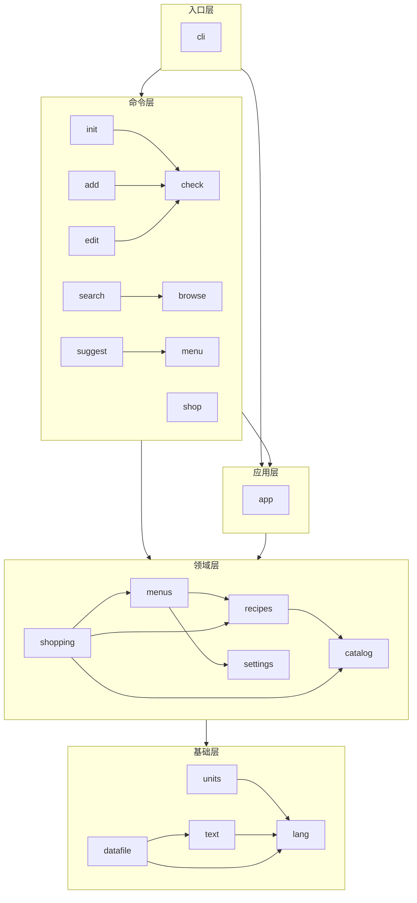

# recipe-menu 总体架构

本文档只管跨功能的问题：技术栈、模块以及模块之间允许的依赖方向、数据模型、错误、输出和测试。每个功能的接口写在该功能的设计文档里，并遵守这里的规则。理由记录在 `docs/adr/` 的决策记录里。

## 1. 背景和约束

- **先 Windows，CI 用 Linux。** 工具运行在 Troy 的 Windows 11 电脑上，在 Windows Terminal 里使用 Windows PowerShell 5.1 和 PowerShell 7。CI 也在 Linux 上运行测试（[需求 7](requirements.zh-CN.md#7-非功能需求)）。所以代码和测试都用 `pathlib` 构造路径，同一套测试在两个系统上都能通过。
- **PATH 上的一个命令。** 在 PowerShell 里从任何文件夹都能运行 `recipe-menu`（[需求 7](requirements.zh-CN.md#7-非功能需求)）。Troy 用 `uv tool install` 安装它（ADR-0006）。
- **中文文字。** 数据文件是 UTF-8，带不带字节顺序标记都可以。不改任何 Windows 设置，中文在 Windows Terminal 里也能正确显示；在对齐的表格里，一个汉字占两列（[需求 7](requirements.zh-CN.md#7-非功能需求)，ADR-0004）。
- **不用网络。** 工具从不使用网络（[需求 7](requirements.zh-CN.md#7-非功能需求)）。没有模块引用网络库，技术栈里也没有哪一部分在运行时需要网络。
- **数据在代码之外。** 数据文件夹是 `~/recipe-menu`，或者 `--data`、`RECIPE_MENU_DATA` 指定的文件夹（[需求 3](requirements.zh-CN.md#3-用户如何使用)）。仓库里只有测试用的示例数据和 `init` 写出的文件。
- **你的文件保持你写的样子。** `init` 和 `menu new` 只在文件不存在时创建文件。`shop` 只替换 `shopping/` 里它自己那一周的文件。v0.1 的其他命令不写任何文件（[需求 3](requirements.zh-CN.md#3-用户如何使用)）。
- **每条提示都有两种语言。** 所有提示、表头、单位名、星期名和餐名都有英文和中文，并跟随所选语言（[需求 3](requirements.zh-CN.md#3-用户如何使用) 和 [7](requirements.zh-CN.md#7-非功能需求)，ADR-0004）。
- **每处错误的位置。** 关于数据文件的提示写出文件和文件里的位置：语法错误写行号，值错误写字段，比如“食材 3”或“周一晚餐”（[需求 3](requirements.zh-CN.md#3-用户如何使用)）。
- **退出码。** 命令成功时退出码为 0，数据有错误或缺文件时为 1，命令行写错时为 2（[需求 3](requirements.zh-CN.md#3-用户如何使用)）。
- **规模和速度。** 工具能处理 1,000 个菜谱、300 种目录食材和 52 个周菜单；在 Troy 的电脑上，`check`、`list`、`show`、`search`、`menu show` 和 `shop` 都在 1 秒内结束（PT01，[需求 7.1](requirements.zh-CN.md#71-性能指标)）。第 8 节限制每个命令读取的内容，ADR-0002 估算解析的开销。

## 2. 技术栈

| 部分 | 选择 | 理由 |
| --- | --- | --- |
| 语言 | Python 3.13 或更新版本，运行时只用标准库（ADR-0001）。 | Troy 的 Python 语言包在 Windows 和 CI 上都能运行它。标准库能读 TOML、认识 ISO 周、做精确分数运算、给出字符宽度，所以工具不需要第三方包。 |
| 数据文件 | TOML 1.0，格式与 `docs/prototypes/example-data.md` 相同，用 `tomllib` 读取（ADR-0002）。 | TOML 支持注释和 Unicode 字符串，缩进没有含义，所以 Troy 用记事本就能编辑。`tomllib` 能给出语法错误所在的行。 |
| 写文件 | 代码按模板生成文本，经 `datafile` 写出。 | `init`、`menu new` 和 `shop` 都写全新的文件，所以不需要 TOML 写入库。 |
| 命令行 | `cli` 里的一个小解析器，不用 `argparse`（ADR-0005）。 | 帮助和每条错误都必须有两种语言。`argparse` 会输出它自己的英文提示。 |
| 数量 | `fractions.Fraction`（ADR-0007）。 | 按份数缩放和向上取整都保持精确。2 份的菜谱做 3 份时，300 g 就是 450 g，不会变成 450.00000001 g 再向上取整成 451 g。 |
| 周和日期 | `datetime.date.isocalendar` 和 `datetime.date.fromisocalendar`。 | `2026-W47` 这样的 ISO 周直接由标准库算出。 |
| 字符宽度 | `unicodedata.east_asian_width`。 | 宽字符和全角字符占两列，其他字符占一列（ADR-0004）。 |
| 环境 | Python 语言包的 mamba 环境，由 uv 安装 `requirements-dev.lock`。 | troy-mode 对 Python 项目的规定。不建 `.venv` 文件夹。 |
| 构建 | hatchling、包 `src/recipe_menu`，以及 `pyproject.toml` 里的控制台脚本 `recipe-menu = "recipe_menu.cli:main"`。 | 语言包的构建后端。控制台脚本由 F05 加入。 |
| 安装 | 用 `uv tool install` 从发布标签安装（ADR-0006）。 | uv 在语言包的环境里。工具有自己的环境，所以在分支上开发不会改变已安装的命令。 |
| 检查 | ruff、严格模式的 mypy、pytest 和 coverage.py，使用语言包的设置。 | 语言包的 CI 作业运行它们。troy-check 直接在代码上检查 R04 到 R07，并读取测试报告和覆盖率报告来检查 R09 到 R11。 |

## 3. 模块

包是 `src/recipe_menu/` 里的 `recipe_menu`。每个模块是一个文件夹，它的 `__init__.py` 是其他模块唯一可以引用的文件。表格从基础模块往上一直排到 `cli`。每一行都写明由哪些功能构建这个模块。

| 模块 | 负责什么 | 对外接口 | 可以依赖谁 |
| --- | --- | --- | --- |
| lang | `src/recipe_menu/lang/**`。由 F01 和 F02 构建。语言类型，以及有两种语言、缺一种时改用另一种的文字。 | `src/recipe_menu/lang/__init__.py` | 无 |
| units | `src/recipe_menu/units/**`。由 F01 构建。单位和数量：用任一语言读取，换算、缩放、相加，并写出。 | `src/recipe_menu/units/__init__.py` | lang |
| text | `src/recipe_menu/text/**`。由 F02 构建。提示类型和公用提示、语言选择、英文复数和列举、显示宽度、对齐的表格，以及控制台输出流。 | `src/recipe_menu/text/__init__.py` | lang |
| datafile | `src/recipe_menu/datafile/**`。由 F03 创建，之后的功能按需加入写文件的部分和公用的检查。数据文件夹里各文件的路径、读取 TOML 文件、写文件、带位置的问题，以及几个读取模块共用的值检查，比如份数。 | `src/recipe_menu/datafile/__init__.py` | lang, text |
| catalog | `src/recipe_menu/catalog/**`。由 F03 构建。读取目录和常备清单，按任一语言的名称找到食材和标签，并报告其中的问题。 | `src/recipe_menu/catalog/__init__.py` | lang, units, text, datafile |
| recipes | `src/recipe_menu/recipes/**`。由 F04 构建。列出菜谱 ID，读取菜谱文件，并报告其中的问题。 | `src/recipe_menu/recipes/__init__.py` | lang, units, text, datafile, catalog |
| settings | `src/recipe_menu/settings/**`。由 F05 构建。读取设置文件：语言、几餐和默认份数。v0.2 里 F14 和 F16 加入各自的设置。 | `src/recipe_menu/settings/__init__.py` | lang, text, datafile |
| menus | `src/recipe_menu/menus/**`。由 F06 构建。ISO 周、本周和下周、两种语言的日期和星期名，以及读取周菜单文件并报告其中的问题。 | `src/recipe_menu/menus/__init__.py` | lang, text, datafile, settings, recipes |
| shopping | `src/recipe_menu/shopping/**`。由 F12 构建。由一个周菜单、它的菜谱、目录和常备清单生成购物清单。不读任何文件。 | `src/recipe_menu/shopping/__init__.py` | lang, units, catalog, recipes, menus |
| app | `src/recipe_menu/app/**`。由 F05 构建。连接 cli 和各命令的值：上下文、命令描述、用法错误，以及显示数据文件中问题的那几行。 | `src/recipe_menu/app/__init__.py` | lang, text, datafile, settings |
| check | `src/recipe_menu/commands/check/**`。由 F07 构建。check 命令。add 和 edit 复用它来检查单个菜谱。 | `src/recipe_menu/commands/check/__init__.py` | app, lang, units, text, datafile, catalog, recipes, settings, menus, shopping |
| init | `src/recipe_menu/commands/init/**`。由 F08 构建。init 命令和它写出的示例文件。 | `src/recipe_menu/commands/init/__init__.py` | app, lang, units, text, datafile, catalog, recipes, settings, menus, shopping, check |
| browse | `src/recipe_menu/commands/browse/**`。由 F09 构建。list 和 show 命令。 | `src/recipe_menu/commands/browse/__init__.py` | app, lang, units, text, datafile, catalog, recipes, settings, menus, shopping |
| search | `src/recipe_menu/commands/search/**`。由 F10 构建。search 命令。 | `src/recipe_menu/commands/search/__init__.py` | app, lang, units, text, datafile, catalog, recipes, settings, menus, shopping, browse |
| menu | `src/recipe_menu/commands/menu/**`。由 F11 构建。menu new 和 menu show 命令。 | `src/recipe_menu/commands/menu/__init__.py` | app, lang, units, text, datafile, catalog, recipes, settings, menus, shopping |
| shop | `src/recipe_menu/commands/shop/**`。由 F13 构建。shop 命令：终端里的清单和 Markdown 勾选清单。 | `src/recipe_menu/commands/shop/__init__.py` | app, lang, units, text, datafile, catalog, recipes, settings, menus, shopping |
| suggest | `src/recipe_menu/commands/suggest/**`。由 F14 在 v0.2 构建。menu suggest 命令。 | `src/recipe_menu/commands/suggest/__init__.py` | app, lang, units, text, datafile, catalog, recipes, settings, menus, shopping, menu |
| add | `src/recipe_menu/commands/add/**`。由 F15 在 v0.2 构建。add 命令。 | `src/recipe_menu/commands/add/__init__.py` | app, lang, units, text, datafile, catalog, recipes, settings, menus, shopping, check |
| edit | `src/recipe_menu/commands/edit/**`。由 F16 在 v0.2 构建。edit 命令。 | `src/recipe_menu/commands/edit/__init__.py` | app, lang, units, text, datafile, catalog, recipes, settings, menus, shopping, check |
| cli | `src/recipe_menu/cli/**`、`src/recipe_menu/__init__.py`、`src/recipe_menu/__main__.py`、`src/recipe_menu/commands/__init__.py`。由 F05 构建。程序入口：命令行解析器、帮助和版本、数据文件夹的位置、启动时的语言选择、运行命令，以及退出码。 | `src/recipe_menu/cli/__init__.py` | lang, text, datafile, settings, app, check, init, browse, search, menu, shop, suggest, add, edit |

## 4. 依赖规则

箭头从一个模块指向它可以依赖的模块。下图画出五个层，以及同一层内部的箭头。第 3 节的表格才是准确的清单，troy-check 读取它来检查 R07。

- 一个模块只依赖更低层的模块，以及本层里有箭头指向的模块。没有模块依赖更高层的模块，也没有模块依赖 `cli`。
- 一个模块引用另一个模块时，只能写 `recipe_menu.<模块>` 或 `recipe_menu.commands.<模块>`，也就是那个模块的 `__init__.py`。在自己的文件夹里，模块直接引用自己的文件，从不引用自己的 `__init__.py`。
- 基础层和领域层的模块从不打印、从不读取命令行或环境，也从不退出程序。只有 `cli` 接触外部世界（第 8 节）。
- `shopping` 不读任何文件。它把其他模块已经读出的值变成购物清单，所以 F12 的测试不需要文件。
- `units` 不使用 `text`，因为 F01 排在 F02 前面。它用一个说明错在哪里的值来报告错误的数量，由 `catalog` 和 `recipes` 把这个值变成提示。
- 有两条依赖来自公用模块，而不是来自需求的依赖图。F01 创建 `lang`，F02 使用它。F03 创建 `datafile`，F05 使用它。两条都指向更早的功能，符合设计检查清单的要求。
- 命令类功能在自己的 mock PR 里把命令加进 `cli` 的命令列表，这样它的测试就能通过 `recipe_menu.cli.main` 运行它。这一条是命令类功能在 `cli` 里唯一的改动。

## 5. 数据模型

下面这些值会跨越模块边界。每个值都是不可变的 dataclass 或枚举。具体的名称和签名由各接口设计给出。原始的 TOML 表从不离开读取该文件的模块。

### 5.1 数据文件

每个文件的键和结构就是 `docs/prototypes/example-data.md` 里的样子。F03 到 F06 在各自的设计里列出对每个键的检查。读取时文件按 UTF-8 解码，带不带字节顺序标记都可以。工具写出的文件是不带字节顺序标记的 UTF-8，换行符为 LF。

| 文件 | 内容 | 由谁读取 | 由谁写出 |
| --- | --- | --- | --- |
| `settings.toml` | `language`、`meals` 和 `servings`。v0.2 里 F14 加入每餐几道菜，F16 加入编辑器。 | settings | init |
| `catalog.toml` | `categories`、`ingredients` 和 `tags`，按购物顺序排列。 | catalog | init |
| `pantry.toml` | `pantry`，一个食材名称的列表。 | catalog | init |
| `recipes/<id>.toml` | `name`、`servings`、`tags`、`ingredients` 和 `steps`。 | recipes | init 写出 `tomato-egg.toml`。v0.2 里 add 写出新菜谱。 |
| `menus/<week>.toml` | `week`，然后每天一个表，每餐一个菜的列表。 | menus | menu new 写出空的一周。v0.2 里 menu suggest 填充空的餐。 |
| `shopping/<week>.md` | 一周的 Markdown 勾选清单。 | 没有模块读取 | shop |

`<id>` 是菜谱 ID，`<week>` 是 `2026-W47` 这样的 ISO 周。

### 5.2 值

| 值 | 模块 | 字段 | 说明 |
| --- | --- | --- | --- |
| `Lang` | lang | `EN`，值为 "en"；`ZH`，值为 "zh"。 | 一个 `StrEnum`。它的值就是 `--lang` 和设置里 `language` 接受的值。由 F01 创建。 |
| `BiText` | lang | `en: str 或 None` 和 `zh: str 或 None`，至少有一个。 | 给出要求的语言；缺这种语言时给出另一种。名称和备注都用它。由 F02 加入。 |
| `Unit` | units | 种类（质量、体积或计数），质量和体积单位换算成 g 或 ml 的大小，以及两种语言的名称。 | 需求第 3 节的每个单位各一个成员。 |
| `Quantity` | units | 一个精确的 `amount: Fraction` 加一个 `Unit`，或者“适量”。 | 质量换算成克，体积换算成毫升。计数单位不换算成任何别的单位。 |
| `Message` | text | 一个英文模板和一个中文模板，占位符 `{name}` 完全相同。 | 工具显示的、不属于数据的每一段文字。创建提示时缺一种语言或占位符不同，都会失败。 |
| `DataFolder` | datafile | 根文件夹，以及 5.1 里每个文件的路径。 | 唯一知道各文件名称的地方。 |
| `Problem` | datafile | `severity`（错误或警告）、`file`（相对于数据文件夹的路径）、`place`（行号或字段，两种语言）和 `message`（一个 `Message` 和它的值）。 | 读取函数返回问题，从不把问题当异常抛出。 |
| `Category` | catalog | `key: str` 和 `name: BiText`。 | 文件里的顺序就是购物顺序。 |
| `Ingredient` | catalog | 两种语言都有的 `name: BiText`、`category: Category`，以及默认单位 `unit: Unit 或 None`。 | 两种语言的名称都不能重复。菜谱和常备清单引用同一个 `Ingredient` 值，所以购物清单按同一对象合并食材。 |
| `Tag` | catalog | 两种语言都有的 `name: BiText`。 | |
| `Catalog` | catalog | 分类、食材和标签，按文件顺序排列。 | 按任一语言的名称找到食材或标签。 |
| `Pantry` | catalog | 一组 `Ingredient` 值。 | |
| `Recipe` | recipes | `id: str`、`name: BiText`、`servings: int`（1 或更多）、`tags: tuple[Tag, ...]`、`ingredients: tuple[RecipeIngredient, ...]`，以及每种语言一组字符串元组形式的步骤。 | ID 是去掉 `.toml` 的文件名。ID 按原样精确比较，所以 Windows 和 Linux 的结果相同。 |
| `RecipeIngredient` | recipes | `ingredient: Ingredient`、`quantity: Quantity` 和 `note: BiText 或 None`。 | 没写单位的数量，读取时使用该食材的默认单位。 |
| `Meal` | settings | 按顺序为 `BREAKFAST`、`LUNCH` 和 `DINNER`，带两种语言的名称。 | 一个 `StrEnum`，值就是文件里用的写法。 |
| `Settings` | settings | `language: Lang 或 None`、`meals: tuple[Meal, ...]` 和 `servings: int`。 | 默认值：不指定语言，午餐和晚餐，2 份。 |
| `IsoWeek` | menus | `year: int` 和 `week: int`。 | 写作 `2026-W47`。能给出它的七个日期。`this` 和 `next` 由调用方传入的今天日期算出。 |
| `Dish` | menus | `recipe_id: str` 和 `servings: int`。 | 文件没写份数时，读取函数填入设置里的份数，所以后面的模块不需要为一道菜去读设置。 |
| `WeekMenu` | menus | `week: IsoWeek`，以及周一到周日每天每餐的菜。 | 只包含设置里列出的几餐。 |
| `ShoppingList` | shopping | 这一周、餐数和菜数、按目录顺序分类分组的各行，以及菜单用到的常备食材。 | |
| `ShoppingLine` | shopping | `ingredient: Ingredient` 和 `amounts: tuple[Quantity, ...]`，每种不能互相相加的量一个：克、毫升，以及每个计数单位。 | `amounts` 为空表示“适量”。 |
| `Context` | app | 选定的 `Lang`、`DataFolder`、文件夹里的设置（读不到设置时为默认值）、输出流和错误流，以及今天的日期。 | 由 `cli` 构造并传给命令。v0.2 里 F15 加入输入流，F14 加入随机数生成器。 |
| `Command` | app | 它的命令词，比如 `menu show`；`Message` 形式的帮助行；它的参数和选项；以及运行它并返回退出码的函数。 | 每个命令模块定义自己的命令。 |
| `UsageError` | app | 一个 `Message` 和它的值，以及它的提示行：跟在它后面那一行的 `Message`，或者 `None`（ADR-0008）。 | 唯一有意跨越模块的异常。`cli` 把它变成退出码 2。 |

### 5.3 关系

- 一个 `Recipe` 引用 `Catalog` 里的 `Ingredient` 和 `Tag` 值。`Pantry` 引用 `Ingredient` 值。
- 一个 `WeekMenu` 只用 ID 引用菜谱。命令自己读取它需要的菜谱。
- 一个 `ShoppingList` 来自一个 `WeekMenu`、它各道菜的菜谱、`Catalog` 和 `Pantry`。
- 一个 `Problem` 用相对于 `DataFolder` 根文件夹的路径指向它的文件。

## 6. 错误处理

| 类型 | 怎么表示 | 由谁捕获 | 退出码 | 用户看到什么 |
| --- | --- | --- | --- | --- |
| 数据文件里的值有错 | 读取函数返回的一列 `Problem` 值。 | 没有，因为它们是值。 | 1 | 一行写文件和位置，下一行缩进写提示，和 F07 原型一样。`check` 以外的命令遇到第一个错误就停下，并加上“运行“recipe-menu check”查看所有问题。” |
| 语法错误，或者文件不是 UTF-8 | `tomllib.TOMLDecodeError`、`tomllib` 遇到位数太多的数字或嵌套太深时抛出的普通 `ValueError` 或 `RecursionError`，或者 `UnicodeDecodeError`。`datafile` 把每一种都变成带行号的 `Problem`（ADR-0002）。 | datafile | 1 | 文件、行号，以及用所选语言写的原因。 |
| 文件读不了或写不了 | `OSError`，由 `datafile` 变成 `Problem`。 | datafile | 1 | 文件和出了什么问题：文件不存在、没有权限，或者其他系统错误。 |
| 缺数据文件夹、菜单或菜谱 | cli 或命令检查的一个结果。 | 数据文件夹由 cli 检查，只要命令的 `FolderUse` 要求（F05 设计 2.5）。菜单或菜谱由命令自己检查（ADR-0008）。 | 1 | 一条提示，说明下一步运行什么，和原型一样。 |
| 命令行或参数值写错 | `UsageError`，由解析器或命令抛出。 | cli | 2 | 提示，然后是错误指定的那一行，比如指向 `recipe-menu --help` 的一行，和 F05 原型一样。提示本身已经说明怎么写的错误（比如 F11 里写错的周）可以不指定这一行（ADR-0008）。 |
| Ctrl+C | `KeyboardInterrupt`。 | cli | 130 | 不再输出任何内容。写文件是原子操作，所以不会留下写了一半的文件。 |
| bug | 任何其他异常。 | 没有 | 1，Python 的默认值 | stderr 上的 Python 回溯信息。出现回溯信息就一定是 bug。 |

- 读取函数遇到坏数据从不抛异常。它跳过出错的部分，记下一个 `Problem`，然后继续，所以运行一次 `check` 就能列出所有问题。
- 警告（比如缺一种语言）从不改变退出码。
- `except` 子句写明它捕获的异常，而且只写在把异常变成 `Problem`、结果或 `UsageError` 的地方。没有代码捕获 `Exception`，也没有代码使用不带异常名的 `except`。
- 解析器的英文原文从不单独出现在用户面前。`datafile` 把它认识的原因变成提示，其他原因则显示一条通用提示和行号。
- 问题里的文件路径相对于数据文件夹，使用系统的分隔符，比如 Windows 上的 `recipes\mapo-tofu.toml`。其他提示用完整路径写出文件或文件夹。`init` 的失败是第一条规则的例外，因为它的数据文件夹是你刚刚要它创建的，而不是你每天在用的那个（ADR-0009）。失败的第一行用完整路径 `str(context.folder.root / problem.file)` 写出 `init` 没能创建的文件夹或文件。在数据文件夹本身或它上面的文件夹处失败时，问题的文件是 `Path(".")`，所以这一行写出数据文件夹。`Problem` 仍然保存相对于数据文件夹的文件（5.2）。F11 的 `menu new` 和 F13 的 `shop` 也可以用完整路径写出它们没能写入的文件。
- 命令的输出写到 stdout。以退出码 1 或 2 结束命令的提示写到 stderr。`check` 的报告就是它的输出，所以无论退出码是什么都写到 stdout。
- `datafile` 以独占模式创建新文件，所以 `init` 和 `menu new` 会拒绝，而不会覆盖。要替换的文件（比如一周的购物清单）先写到同一文件夹里的临时文件，再移过去替换旧文件。

## 7. 日志

- 工具不写日志，也不设置任何 `logging` 处理器。它显示的只有它的输出和提示。
- 数据不会离开数据文件夹。工具不在别处写日志文件、缓存或使用数据。
- bug 会在 stderr 上显示 Python 的回溯信息（第 6 节）。
- 用于诊断的选项（比如 `--verbose`）属于新需求，要走变更流程。

## 8. 命名和编码规范

这些规范是对 R04 到 R07 的补充。标有“Lint”的规范可以用 ruff 的禁用 API 规则（`TID251`）检查。规则变更流程可以把其中每一条变成 `docs/rules.md` 里的项目规则。

- **布局。** 第 3 节的每个模块是一个文件夹。它的 `__init__.py` 存放或引入模块的公开名称，并在 `__all__` 里列出它们；mypy 严格模式要求这样做，才认可从其他文件引入的名称。文件夹里的其他文件都是模块内部的。`src/recipe_menu/` 下的每个文件恰好属于一个模块。
- **提示。** 显示文字的模块把提示放在自己文件夹的 `messages.py` 里。每条提示是一个 `Message` 常量，名称用 UPPER_SNAKE，说明提示的内容，比如 `UNKNOWN_INGREDIENT`。
- **用户看到的文字。** 用户看到的每一段文字都是 `Message`，只有来自文件的数据和不属于任何语言的符号（比如 `—` 和 `×`）除外。英文复数、“a, b, and c”和“a、b、c”这样的列举，以及显示宽度，都由 `text` 提供。没有模块自己拼这些内容。
- **名称。** 名称遵守 PEP 8，由 ruff 的 `N` 规则检查：模块、函数和变量用 snake_case，类用 CapWords，常量用 UPPER_SNAKE。命令模块使用命令的名称。F09 的 `list` 和 `show` 共用 `browse`，F11 的 `menu new` 和 `menu show` 共用 `menu`，F14 的 `menu suggest` 是 `suggest`。数据文件里的键是小写英文单词，一个键需要两个词时用 `_` 连接。
- **数量。** 每个数量都是 `Fraction`。不用 `float` 存放数量（ADR-0007）。
- **值。** 跨越模块的值是带 `slots=True` 的冻结 dataclass，或者枚举。其中的集合用元组或 frozenset。
- **文件。** 路径是 `pathlib.Path` 值。每次打开文件都写明编码：读用 `utf-8-sig`，写用 `utf-8` 加 `newline="\n"`。只有 `datafile` 打开数据文件。
- **外部世界（Lint）。** 只有 `cli` 读取 `sys.argv`、环境变量、主文件夹、今天的日期、控制台输出流和随机种子。它通过 `Context` 和函数参数把这些传下去，所以测试可以给出固定的值。
- **输出。** 没有代码调用 `print()`，也没有代码直接写 `sys.stdout` 或 `sys.stderr`。输出写到 `Context` 里的流。ruff 的 `T20` 规则已经检查 `print()`。
- **不用网络（Lint）。** 没有模块引用网络模块，比如 `socket`、`http`、`urllib.request`、`ftplib` 或 `smtplib`。
- **只读需要的内容。** 命令只读它需要的文件。`show`、`menu show` 和 `shop` 解析设置、目录、需要时的常备清单、菜单，以及它们点名的菜谱。`list`、`search` 和 `check` 解析所有菜谱。`recipes` 从 `recipes/` 里的文件名列出菜谱 ID，不解析文件。
- **状态。** 模块不在模块级别保存可变状态，引入模块时除了定义名称之外什么也不做。
- **异常。** `except` 子句写明它捕获的异常（第 6 节）。

## 9. 第三方依赖

工具运行时不使用任何第三方包。表格列出构建和检查它所用的包。每一个都由 Python 语言包带来，troy-init 的语言步骤安装它们，不需要另行批准。

| 名称 | 版本 | 许可证 | 理由 | 批准记录 |
| --- | --- | --- | --- | --- |
| coverage | 7.6 或更新 | Apache-2.0 | 为 R11 统计行覆盖率和分支覆盖率。 | ADR-0001 |
| mypy | 1.13 或更新 | MIT | 严格模式的类型检查。 | ADR-0001 |
| pytest | 8.3 或更新 | MIT | 测试运行器，以及供 R09 和 R10 使用的 JUnit 报告。 | ADR-0001 |
| ruff | 0.8 或更新 | MIT | 代码检查、格式化，以及 R05 的文档注释规则。 | ADR-0001 |
| hatchling | 1.25 或更新 | MIT | 构建 wheel 和 `recipe-menu` 命令的构建后端。 | ADR-0001 |
| uv | 按语言包的 `environment.yml`，来自 conda-forge | MIT 或 Apache-2.0 | 为开发安装锁定文件，并为日常使用安装工具。 | ADR-0001, ADR-0006 |

## 10. 测试配置

- 测试运行器：pytest，使用语言包的设置。测试放在 `tests/`，文件名为 `test_<功能>_<主题>.py`，比如 `tests/test_f04_recipes.py`，并按 R06 拆分以控制长度。测试文件名在 `tests/` 里不能重复，因为 pytest 的默认引入模式要求这样。版本测试放在 `version-tests/`，只在发布时运行。
- 测试如何标注功能编号和 bug 编号（R10）：每个测试自己的名称以小写的用例编号或 bug 编号开头，比如 `test_f04_t07_unknown_ingredient` 或 `test_b12_empty_menu`。troy-check 从 pytest 的 JUnit 报告里读取名称，并根据 `main` 的历史判断哪些失败是预期的。所以测试不会因为功能还没做完而带上 `xfail` 或 `skip` 标记。
- 改动代码的覆盖率如何统计（R11）：coverage.py 用 `coverage run -m pytest` 统计 `src` 里的行和分支，再用 `coverage xml` 写出 `reports/coverage.xml`。troy-check 把这份报告和 PR 改动的行做比较。
- 示例数据：`tests/data/example/` 存放 `docs/prototypes/example-data.md` 里完整的示例数据文件夹，包括全部七个菜谱和 `2026-W47` 的菜单。一个 fixture 把它复制到 `tmp_path`，所以没有测试会改动仓库或碰到 `~/recipe-menu`。
- 在测试进程里运行：测试用命令的参数、数据文件夹、一个固定的日期和字符串流调用 `recipe_menu.cli.main`，然后检查退出码和文字。原型里的日期是 2026 年 11 月 10 日，星期二。
- 两个系统：每个测试在 Linux 和 Windows 上都能通过，预期的路径由 `pathlib` 构造。只能在一个系统上运行的用例，要在测试计划里写明原因。
- 控制台：CI 机器都没有 Windows 控制台。所以版本测试计划请 Troy 在 Windows Terminal 里，用 Windows PowerShell 5.1 和 PowerShell 7 检查中文输出。
- 性能（PT01）：一个辅助函数在 `tmp_path` 里生成有 1,000 个菜谱、300 种食材和 52 个周菜单的数据文件夹。测试用 `python -m recipe_menu` 把每个命令从启动到退出运行 5 次，取中位数。它在 Troy 的电脑上运行（R14）。放在 `tests/` 里的性能用例也会在 CI 的 Linux 上运行，而那台机器不是固定的。所以测试经理要给这样的用例留出在那里也成立的余量，或者把它放进 `version-tests/`。

## 11. 决策记录

Troy 于 2026-11-10 批准本文档，接受了 ADR-0001 到 ADR-0007；于 2026-11-12 在 F05 设计里接受了 ADR-0008；又于 2026-11-13 在 F08 设计里接受了 ADR-0009。

| ADR | 标题 | 状态 |
| --- | --- | --- |
| ADR-0001 | Python 3.13，运行时只用标准库 | 已接受 |
| ADR-0002 | TOML 数据文件，用 tomllib 读取 | 已接受 |
| ADR-0003 | 分层的模块，每个模块是一个只有一个接口文件的文件夹 | 已接受 |
| ADR-0004 | 提示、显示宽度和控制台 | 已接受 |
| ADR-0005 | 自己写命令行解析器，不用 argparse | 已接受 |
| ADR-0006 | 用 uv tool 安装 recipe-menu | 已接受 |
| ADR-0007 | 用分数表示精确的数量 | 已接受 |
| ADR-0008 | 用法错误的提示行、数据文件夹的检查，以及 tomllib 的其他异常 | 已接受 |
| ADR-0009 | init 失败时用完整路径写出问题的文件 | 已接受 |

## 12. 修改记录

| 版本 | 日期 | 修改 |
| --- | --- | --- |
| 0.1 | 2026-11-10 | 初稿。 |
| 1.0 | 2026-11-10 | Troy 批准。 |
| 1.1 | 2026-11-12 | 记下 Troy 于 2026-11-12 在 F05 设计里做出的决定 A 到 C（ADR-0008）。第 6 节：用法错误显示它指定的那一行，提示本身已经说明怎么写的错误可以不指定这一行（A）。只要命令的 `FolderUse` 要求，就由 cli 检查数据文件夹是否存在，菜单或菜谱仍由命令自己检查（B）。语法错误也包括 `tomllib` 抛出的普通 `ValueError` 和 `RecursionError`（C）。第 5.2 节：`UsageError` 带有它的提示行；文件夹里读不到设置时，`Context` 里是默认的设置。第 3 节：`app` 一行写上显示问题的那几行，`datafile` 一行写上公用的值检查，比如份数。 |
| 2.0 | 2026-11-12 | Troy 批准。 |
| 2.1 | 2026-11-13 | 记下 Troy 于 2026-11-13 在 F08 设计里为待定问题 D 选定的做法 1（ADR-0009）。第 6 节：`init` 失败时，第一行用完整路径写出 `init` 没能创建的文件夹或文件；在数据文件夹本身或它上面的文件夹处失败时，写出数据文件夹。`Problem` 仍然保存相对于数据文件夹的文件，读取函数或检查报告的每个问题仍然写相对路径。F11 的 `menu new` 和 F13 的 `shop` 也可以用完整路径写出它们没能写入的文件。第 11 节列出 ADR-0009。 |
| 3.0 | 2026-11-13 | Troy 批准。 |
