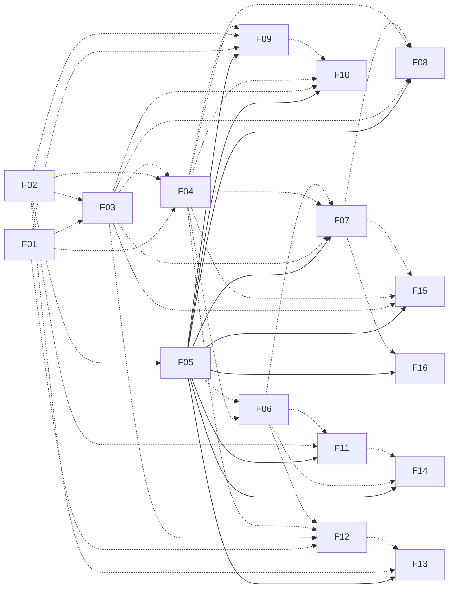

# recipe-menu requirements

## 1. Goal

`recipe-menu` is a command-line tool that keeps Troy's recipes, lays out a week's menu from them, and makes the shopping list for that menu. Every recipe and every message can be in Chinese or English. The shopping list replaces adding up ingredients by hand: it scales each dish to its servings, merges the same ingredient across dishes, and leaves out what is always at home.

## 2. Users

Troy is the only user. Troy runs the tool on Troy's Windows 11 PC, in Windows Terminal with PowerShell. Troy plans the menu about once a week, makes the shopping list once or twice a week, and adds or changes recipes now and then. Other people may read a saved shopping list file, but they do not run the tool.

## 3. How users interact with it

You work with two things: plain-text files in a data folder, which you edit in any text editor, and the `recipe-menu` command, which reads them. The files are UTF-8 text. The architecture picks their format. The prototypes show TOML as an example, and `docs/prototypes/example-data.md` shows the example data that every prototype uses.

**The data folder.** The data folder is `~/recipe-menu`, which is `C:\Users\Troy\recipe-menu` on Troy's PC (Q15). The `--data` option or the `RECIPE_MENU_DATA` environment variable names another folder, such as one in OneDrive. The data folder holds these files:

| Path | What it holds | Who writes it |
| --- | --- | --- |
| `settings` | The default language, the meals of a day, and the default servings of a dish. | You. `init` creates it. |
| `catalog` | The shopping categories in order, the ingredients, and the tags, each with a Chinese and an English name. | You. `init` creates it. |
| `pantry` | The ingredients you always have at home. | You. `init` creates it. |
| `recipes/` | One file per recipe. | You. |
| `menus/` | One file per week menu. | You. `menu new` creates each one. |
| `shopping/` | One Markdown checklist per week. | `shop`. |

**A recipe** has these parts:

- an ID, which is its file name without the extension, such as `tomato-egg`;
- a Chinese name and an English name;
- the servings it makes;
- tags from the catalog, such as 快手 (quick) or 素 (vegetarian);
- ingredients, each with its catalog name in either language, a quantity with a unit or "to taste" (适量), and an optional note in each language, such as 切丝 (shredded);
- steps in Chinese and steps in English.

A name, a note, or the steps may lack one language. Commands then show the other language, and `check` warns about the gap.

**Units.** A quantity uses one of these units, written in either language:

- mass: g (克), kg (千克 or 公斤), 斤 (500 g), and 两 (50 g);
- volume: ml (毫升), L (升), tsp (茶匙, 5 ml), and tbsp (汤匙, 15 ml);
- counts: piece (个), stalk (根), clove (瓣), slice (片), block (块), bunch (把), can (罐), and pack (包);
- no quantity: to taste (适量).

A quantity without a unit uses the ingredient's default unit from the catalog. `show` writes a quantity in the unit that the recipe uses. In English, 斤 is "jin" and 两 is "liang".

**A week menu** belongs to one ISO week, such as `2026-W47`, which runs from Monday 16 November to Sunday 22 November 2026. It has the seven days, Monday to Sunday, and the meals that the settings name: breakfast (早餐), lunch (午餐), and dinner (晚餐). The default meals are lunch and dinner. Each meal holds zero or more dishes (Q16). A dish is a recipe ID with optional servings. A dish without servings uses the default servings from the settings, which start at 2 (Q17). A command that takes a week accepts an ISO week, `this`, or `next`. Without a week, it uses this week.

**The language.** Every command takes `--lang en` or `--lang zh`. Without the option, a command uses the language in the settings, and without that, English. Every message, table heading, unit name, day name, and meal name follows the language. The shopping list shows mass in g and kg, and volume in ml and L, in both languages.

**The main flows.**

1. Start:
   1. Run `recipe-menu init`. It creates the data folder with the settings, a catalog of common ingredients, a pantry list, and one example recipe in both languages.
   2. Add your recipes as files in `recipes/`. Add any missing ingredients to the catalog.
   3. Run `recipe-menu check`. Fix what it reports, and run it again until it reports no errors.
2. Find a recipe:
   1. Run `recipe-menu list` to see your recipes, or `recipe-menu list --tag 快手` to see only the quick ones.
   2. Run `recipe-menu search 番茄` to find recipes by name, ingredient, or tag, in either language.
   3. Run `recipe-menu show tomato-egg` to read one recipe. Add `--servings 4` to scale its quantities.
3. Plan the week:
   1. Run `recipe-menu menu new next`. It creates an empty menu file for next week.
   2. Open the file and add recipe IDs to the meals.
   3. Run `recipe-menu check`, then `recipe-menu menu show next` to see the week as a table.
4. Shop:
   1. Run `recipe-menu shop next`. It prints the shopping list and saves it as `shopping/2026-W47.md`.
   2. Open the Markdown file on your phone through the sync you already use, and tick items off in the store.

In v0.2, `menu suggest` fills the empty meals of a week for you, `add` asks for a new recipe one line at a time, and `edit` opens a recipe in your editor and checks it after you close the editor.

**The shopping list.** For one week menu, `shop` follows these rules:

1. It scales each dish's ingredients by the dish's servings divided by the recipe's servings.
2. It merges the lines of each catalog ingredient from all dishes into one line.
3. It adds up mass in grams, volume in millilitres, and each count unit on its own. It never converts mass to volume, or either one to a count.
4. It shows quantities that cannot be added side by side on one line, such as `葱 5 根 + 1 把`.
5. It shows "to taste" for an ingredient that has no quantity in any dish.
6. It leaves out the pantry's ingredients, and names the ones that the menu uses in one line at the end.
7. It groups the lines by category in the catalog's order. Within a category, the lines follow the catalog's order of ingredients.
8. It rounds counts, grams, and millilitres up to whole numbers (Q18).
9. It shows 1000 g or more in kg, and 1000 ml or more in L, with at most two decimals.

**Errors.** Every message about a data file names the file and the place in it. The place is the line for a syntax mistake, and the field, such as "ingredient 3" or "Monday dinner", for a wrong value. A command exits with code 0 when it worked, 1 when the data has an error or a file is missing, and 2 when the command line is wrong.

**Your files stay as you wrote them.** `init` and `menu new` create a file only where none exists, and refuse otherwise. `shop` writes only its own file in `shopping/`, and replaces the file of the same week. v0.1 changes no other file.

### 3.1 Prototypes

Each prototype is a PowerShell session in Windows Terminal that runs the same commands in English and in Chinese.

| Prototype | Feature | File |
| --- | --- | --- |
| Example data | F03, F04, F05, F06 | `docs/prototypes/example-data.md` |
| Help, language, and data folder | F05 | `docs/prototypes/F05-command-line.md` |
| Check the data files | F07 | `docs/prototypes/F07-check.md` |
| Start a data folder | F08 | `docs/prototypes/F08-init.md` |
| List and show recipes | F09 | `docs/prototypes/F09-list-show.md` |
| Search recipes | F10 | `docs/prototypes/F10-search.md` |
| Create and show a week menu | F11 | `docs/prototypes/F11-menu.md` |
| Shopping list | F12, F13 | `docs/prototypes/F13-shop.md` |
| Suggest a week menu | F14 | `docs/prototypes/F14-suggest.md` |
| Add a recipe | F15 | `docs/prototypes/F15-add.md` |
| Edit a recipe | F16 | `docs/prototypes/F16-edit.md` |

## 4. Features

| ID | Feature | Hard dependencies | Soft dependencies | Version | Status |
| --- | --- | --- | --- | --- | --- |
| F01 | Quantities and units | None | None | v0.1 | Not started |
| F02 | Bilingual terminal output | None | None | v0.1 | Not started |
| F03 | Catalog and pantry | None | F01, F02 | v0.1 | Not started |
| F04 | Recipe files | None | F01, F02, F03 | v0.1 | Not started |
| F05 | Command line and settings | None | F02 | v0.1 | Not started |
| F06 | Week menu files | None | F04, F05 | v0.1 | Not started |
| F07 | Check the data files | F05 | F03, F04, F06 | v0.1 | Not started |
| F08 | Start a data folder | F05 | F03, F04, F07 | v0.1 | Not started |
| F09 | List and show recipes | F05 | F01, F02, F04 | v0.1 | Not started |
| F10 | Search recipes | F05 | F03, F04, F09 | v0.1 | Not started |
| F11 | Create and show a week menu | F05 | F02, F06 | v0.1 | Not started |
| F12 | Build the shopping list | None | F01, F03, F04, F06 | v0.1 | Not started |
| F13 | Shopping list command | F05 | F02, F12 | v0.1 | Not started |
| F14 | Suggest a week menu | F05 | F06, F11 | v0.2 | Not started |
| F15 | Add a recipe | F05 | F03, F04, F07 | v0.2 | Not started |
| F16 | Edit a recipe | F05 | F07 | v0.2 | Not started |

Every command depends hard on F05, because F05 provides the `recipe-menu` command that runs it. The other dependencies are soft: the feature can be built against the other feature's mock.

What each feature does:

- **F01 Quantities and units.** Reads a quantity with its unit in either language, or "to taste". Converts mass to grams and volume to millilitres, scales a quantity, adds quantities of the same kind, and writes a quantity in each language with the rounding rules of section 3.
- **F02 Bilingual terminal output.** Holds every message of the tool in English and Chinese, and picks the language: `--lang` first, then the settings, then English. For text that has two languages, such as a recipe name, it shows the chosen language and falls back to the other one. It prints aligned tables in which a Chinese character takes two columns, and it prints Chinese correctly in PowerShell whatever the console code page is.
- **F03 Catalog and pantry.** Reads the catalog: the shopping categories in order, the ingredients with their Chinese and English names, category, and default unit, and the tags with their Chinese and English names. Finds an ingredient or a tag by its name in either language. Reads the pantry list. Reports duplicate names, unknown categories, unknown units, and unknown pantry ingredients.
- **F04 Recipe files.** Reads every file in `recipes/` into recipes with the parts of section 3. Reports each problem with its file and place: a syntax mistake, a missing part, an unknown ingredient or tag, or a wrong quantity or unit. A missing language is a warning.
- **F05 Command line and settings.** Provides the `recipe-menu` command with its subcommands and the options `--lang`, `--data`, `--help`, and `--version`. Finds the data folder, and reads the settings: the language, the meals, and the default servings. Ends every command with the exit codes of section 3.
- **F06 Week menu files.** Reads a week menu file: its ISO week, the days, the meals from the settings, and each dish with its servings. Turns `this` and `next` into ISO weeks. Reports unknown recipe IDs, unknown meals, and wrong servings with their places.
- **F07 Check the data files.** `recipe-menu check` reads the settings, the catalog, the pantry, every recipe, and every week menu. It lists the errors and the warnings with their places, and exits with code 1 when there is an error.
- **F08 Start a data folder.** `recipe-menu init` creates the data folder with the settings, the catalog and the pantry of the example data, the example recipe `tomato-egg`, and the empty folders `menus/` and `shopping/`. The settings get the language that `init` runs in. It refuses when the folder already holds files. `check` reports no errors on what it creates.
- **F09 List and show recipes.** `recipe-menu list` prints a table of the recipes sorted by ID. `--tag` keeps only the recipes with that tag. `recipe-menu show ID` prints one recipe: its names, servings, tags, ingredients with notes, and steps. `--servings N` scales the quantities.
- **F10 Search recipes.** `recipe-menu search WORD...` lists the recipes that match every word in a recipe name, an ingredient name, or a tag name, in either language. A match in English ignores case. Each result says where it matched.
- **F11 Create and show a week menu.** `recipe-menu menu new [WEEK]` creates the week's menu file with every day and meal empty, and refuses when the file exists. `recipe-menu menu show [WEEK]` prints the week as a table of days and meals, with each dish and its servings.
- **F12 Build the shopping list.** Turns a week menu into the shopping list by the rules of section 3: scale, merge, add up, leave out the pantry, group, and round.
- **F13 Shopping list command.** `recipe-menu shop [WEEK]` prints the shopping list in the chosen language and saves it as the Markdown checklist `shopping/<week>.md`.
- **F14 Suggest a week menu.** `recipe-menu menu suggest [WEEK]` fills each empty meal of the week's menu file with recipes chosen at random. Each empty meal gets the number of dishes that the settings give for that meal, 1 by default. No recipe appears twice in the week, and `--tag` limits the choice to recipes with that tag. When no recipe is left to choose, the remaining meals stay empty, and the command says how many. Filled meals and the rest of the file stay as they are. To swap a dish, empty its meal and run `menu suggest` again.
- **F15 Add a recipe.** `recipe-menu add` asks for the ID, the names, the servings, the tags, the ingredients, and the steps, one line at a time. It checks each answer against the catalog, asks again after a wrong answer, and writes a new recipe file.
- **F16 Edit a recipe.** `recipe-menu edit ID` opens the recipe's file in the editor that the settings name, Notepad by default. It waits until you close the editor, and then checks that recipe.

## 5. Dependency graph and order

An arrow points from a feature to a feature that depends on it. A solid arrow is a hard dependency, and a dashed arrow is a soft dependency.

Topological order: F01, F02, F03, F04, F05, F06, F07, F08, F09, F10, F11, F12, F13, F14, F15, F16

## 6. Version plan

| Version | Features | What makes it usable on its own |
| --- | --- | --- |
| v0.1 | F01, F02, F03, F04, F05, F06, F07, F08, F09, F10, F11, F12, F13 | You keep your recipes in files, plan a week by hand, and get the week's shopping list, in Chinese or English. |
| v0.2 | F14, F15, F16 | The tool suggests a week's dishes, and you add and edit recipes from the command line. |

## 7. Non-functional requirements

- **Platform.** The tool runs on Troy's Windows 11 PC, in Windows Terminal with Windows PowerShell 5.1 and PowerShell 7. CI also runs the tests on Linux.
- **Installation.** `recipe-menu` runs from any folder in PowerShell. The architecture says how Troy installs it.
- **Chinese text.** Every data file is UTF-8, with or without a byte order mark. Output shows Chinese correctly in Windows Terminal without a change to any Windows setting. In aligned tables, a Chinese character takes two columns.
- **Privacy.** The tool never uses the network. Recipes, menus, and shopping lists stay in the data folder.
- **Data and code apart.** The data folder lives outside the code repository. The repository holds only the example data that the tests use.
- **Size.** The tool handles at least 1,000 recipes, 300 catalog ingredients, and 52 week menus.
- **Messages.** Every message exists in English and in Chinese.

### 7.1 Performance targets

| ID | Target | How it is measured | Features |
| --- | --- | --- | --- |
| PT01 | `check`, `list`, `show`, `search`, `menu show`, and `shop` each finish within 1 second with 1,000 recipes, 300 catalog ingredients, and 52 week menus in the data folder. | A test generates that data folder and runs each command 5 times on Troy's PC, from start to exit. The median time counts. | F07, F09, F10, F11, F13 |

## 8. Out of scope

- Nutrition, calories, and allergens.
- Prices and budgets.
- Importing recipes from websites, apps, or other files. You type your recipes into files.
- Translating text between Chinese and English. You write both languages, and the tool shows them.
- Languages other than Chinese and English.
- Sharing and syncing. Your own sync tool carries the data folder or a shopping list file.
- A graphical interface, a web page, and a phone app.
- Network access of any kind.
- Converting between mass, volume, and counts, such as grams of rice to cups.
- Tracking how much of each ingredient is at home, beyond the pantry list.
- Printing.

## 9. Open questions

| ID | Question | Proposal | Decision |
| --- | --- | --- | --- |
| Q1 | Which parts have two languages? | The recipes and the tool's messages. `--lang` or the settings pick the language, English by default. A missing language falls back to the other one. | Accepted by Troy on 2026-11-09. |
| Q2 | How do recipes get into the tool? | Plain-text files that you edit by hand, one per recipe, in a data folder outside the repository. `check` reports mistakes. `add` and `edit` come in v0.2. | Accepted by Troy on 2026-11-09. |
| Q3 | How does an ingredient stay one ingredient in both languages? | A catalog gives each ingredient its Chinese name, English name, shopping category, and default unit. Recipes name ingredients from the catalog. | Accepted by Troy on 2026-11-09. |
| Q4 | How is a week's menu made? | In v0.1, you choose the recipes in one menu file per week, with the meals from the settings and the servings of each dish. In v0.2, the tool suggests a week. | Accepted by Troy on 2026-11-09. |
| Q5 | Does the shopping list follow the servings? | Yes. Each recipe states its servings, and the list scales each dish to the servings in the menu. | Accepted by Troy on 2026-11-09. |
| Q6 | What does the shopping list do? | It merges each ingredient, adds quantities of the same kind, keeps "to taste" items once, groups by category, leaves out the pantry, and saves a Markdown checklist. | Accepted by Troy on 2026-11-09. |
| Q7 | Which units are there? | Metric mass and volume, spoons, counts, and 斤 and 两. The shopping list shows mass in g and kg in both languages. | Accepted by Troy on 2026-11-09. |
| Q8 | How do you find recipes? | `list`, `show`, and `search` by name, ingredient, or tag, in either language. | Accepted by Troy on 2026-11-09. |
| Q9 | Which devices? | Windows 11 on Troy's PC, with CI on Linux. Chinese lines up in Windows Terminal. No phone app. | Accepted by Troy on 2026-11-09. |
| Q10 | Are existing recipes imported? | No. The recipes get typed into files. | Accepted by Troy on 2026-11-09. |
| Q11 | What is the command called? | `recipe-menu`. | Accepted by Troy on 2026-11-09. |
| Q12 | How fast must it be? | Every command within 1 second with 1,000 recipes on Troy's PC (PT01). | Accepted by Troy on 2026-11-09. |
| Q13 | What is out of scope? | Section 8. | Accepted by Troy on 2026-11-09. |
| Q14 | What does each version hold? | v0.1 holds the recipes, the menu by hand, and the shopping list. v0.2 holds the suggestions, `add`, and `edit`. | Accepted by Troy on 2026-11-09. |
| Q15 | Where is the data folder by default? | `~/recipe-menu`. `--data` or `RECIPE_MENU_DATA` names another folder, such as one in OneDrive. | Accepted by Troy on 2026-11-10. |
| Q16 | Can a meal hold several dishes? | Yes. A Chinese meal often has several dishes and rice. | Accepted by Troy on 2026-11-10. |
| Q17 | What are the default servings of a dish? | 2, changed in the settings. | Accepted by Troy on 2026-11-10. |
| Q18 | How does the shopping list round? | Up to whole numbers for counts, grams, and millilitres, so that you buy enough. | Accepted by Troy on 2026-11-10. |

## 10. Change log

| Version | Date | Change |
| --- | --- | --- |
| 0.1 | 2026-11-10 | First draft. |
| 1.0 | 2026-11-10 | Approved by Troy. |
