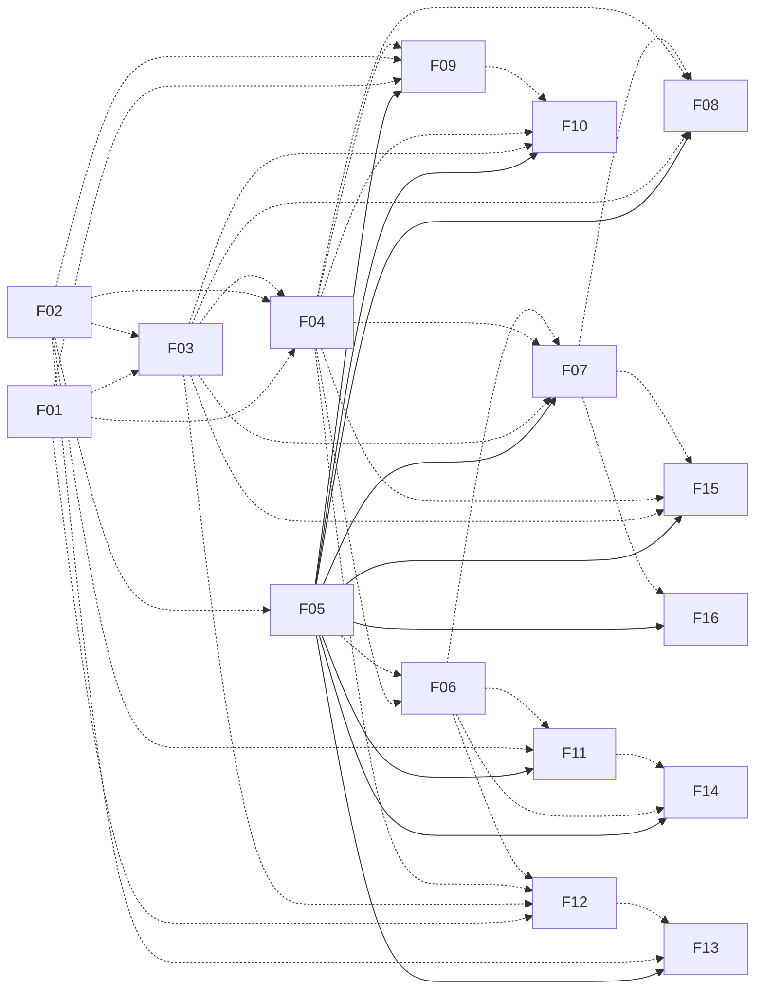

# recipe-menu 需求文档

## 1. 目标

`recipe-menu` 是一个命令行工具：保存 Troy 的菜谱，用这些菜谱排出一周的菜单，再生成这份菜单的购物清单。每个菜谱和每条提示都可以是中文或英文。有了购物清单，就不用再手工加总食材：它按份数换算每道菜，把不同菜里的同一种食材合并，并去掉家里常备的东西。

## 2. 用户

唯一的用户是 Troy。Troy 在自己的 Windows 11 电脑上、在 Windows Terminal 的 PowerShell 里运行这个工具。Troy 大约每周排一次菜单，每周生成一到两次购物清单，偶尔添加或修改菜谱。别人可能会看保存下来的购物清单文件，但不运行这个工具。

## 3. 用户如何使用

你要用到两样东西：数据文件夹里的纯文本文件，你用任何文本编辑器都能修改；以及 `recipe-menu` 命令，它读取这些文件。文件都是 UTF-8 文本，具体格式由架构决定。原型里用 TOML 举例，`docs/prototypes/example-data.md` 给出所有原型共用的示例数据。

**数据文件夹。** 数据文件夹是 `~/recipe-menu`，在 Troy 的电脑上就是 `C:\Users\Troy\recipe-menu`（Q15）。用 `--data` 选项或 `RECIPE_MENU_DATA` 环境变量可以指定别的文件夹，比如 OneDrive 里的一个文件夹。数据文件夹里有这些文件：

| 路径 | 内容 | 由谁写 |
| --- | --- | --- |
| `settings` | 默认语言、一天有哪几餐、一道菜的默认份数。 | 你。`init` 创建它。 |
| `catalog` | 按顺序排列的购物分类、食材和标签，每一项都有中文名和英文名。 | 你。`init` 创建它。 |
| `pantry` | 家里常备的食材。 | 你。`init` 创建它。 |
| `recipes/` | 每个菜谱一个文件。 | 你。 |
| `menus/` | 每个周菜单一个文件。 | 你。每个文件由 `menu new` 创建。 |
| `shopping/` | 每周一份 Markdown 勾选清单。 | `shop`。 |

**一个菜谱**包含以下几部分：

- ID，即去掉扩展名的文件名，比如 `tomato-egg`；
- 中文名和英文名；
- 做出来的份数；
- 来自目录的标签，比如 快手（quick）或 素（vegetarian）；
- 食材，每样食材写目录里的中文名或英文名、带单位的数量或“适量”（to taste），还可以用两种语言各写一条备注，比如 切丝（shredded）；
- 中文步骤和英文步骤。

名称、备注或步骤可以缺一种语言。这时命令会改为显示另一种语言，`check` 也会提醒这处缺漏。

**单位。** 数量使用下面的单位之一，中英文写法都可以：

- 质量：g（克）、kg（千克或公斤）、斤（500 g）、两（50 g）；
- 体积：ml（毫升）、L（升）、tsp（茶匙，5 ml）、tbsp（汤匙，15 ml）；
- 计数：piece（个）、stalk（根）、clove（瓣）、slice（片）、block（块）、bunch（把）、can（罐）、pack（包）；
- 不写数量：适量（to taste）。

没写单位的数量，使用目录里该食材的默认单位。`show` 按菜谱里用的单位显示数量。英文里，斤写作“jin”，两写作“liang”。

**一个周菜单**属于一个 ISO 周，比如 `2026-W47`，即 2026 年 11 月 16 日（周一）至 11 月 22 日（周日）。它有周一到周日七天，以及设置里列出的几餐：早餐（breakfast）、午餐（lunch）、晚餐（dinner）。默认是午餐和晚餐。每餐可以有零道或多道菜（Q16）。一道菜是一个菜谱 ID，可以另写份数；不写份数时使用设置里的默认份数，初始为 2（Q17）。需要指定周的命令接受 ISO 周、`this` 或 `next`；不指定时使用本周。

**语言。** 每个命令都接受 `--lang en` 或 `--lang zh`。不给这个选项时，命令使用设置里的语言；设置里也没有时，使用英文。所有提示、表头、单位名、星期名和餐名都跟随所选语言。购物清单在两种语言下都用 g 和 kg 显示质量，用 ml 和 L 显示体积。

**主要流程。**

1. 开始：
   1. 运行 `recipe-menu init`。它创建数据文件夹，里面有设置、一份常见食材的目录、一份常备清单和一个中英双语的示例菜谱。
   2. 把你的菜谱作为文件加进 `recipes/`。把目录里缺的食材补上。
   3. 运行 `recipe-menu check`。改正它报告的问题，再运行，直到它不再报告错误。
2. 找菜谱：
   1. 运行 `recipe-menu list` 查看所有菜谱，或运行 `recipe-menu list --tag 快手` 只看快手菜。
   2. 运行 `recipe-menu search 番茄`，按名称、食材或标签找菜谱，中英文都可以。
   3. 运行 `recipe-menu show tomato-egg` 查看一个菜谱。加上 `--servings 4` 可以换算数量。
3. 排一周的菜单：
   1. 运行 `recipe-menu menu new next`。它为下周创建一个空的菜单文件。
   2. 打开这个文件，把菜谱 ID 填进各餐。
   3. 运行 `recipe-menu check`，再运行 `recipe-menu menu show next`，以表格形式查看这一周。
4. 购物：
   1. 运行 `recipe-menu shop next`。它打印购物清单，并保存为 `shopping/2026-W47.md`。
   2. 通过你已经在用的同步方式，在手机上打开这个 Markdown 文件，在店里逐项勾选。

在 v0.2 里，`menu suggest` 替你填满一周里的空餐，`add` 逐行询问一个新菜谱，`edit` 用你的编辑器打开一个菜谱，并在你关闭编辑器后检查它。

**购物清单。** 对一个周菜单，`shop` 遵循以下规则：

1. 把每道菜的食材按“这道菜的份数 ÷ 菜谱的份数”换算。
2. 把所有菜里同一种目录食材的各行合并成一行。
3. 质量按克相加，体积按毫升相加，每种计数单位各自相加。它从不把质量换算成体积，也不把两者换算成计数。
4. 不能相加的数量在同一行里并列显示，比如 `葱 5 根 + 1 把`。
5. 某种食材在所有菜里都没有数量时，显示“适量”。
6. 去掉常备清单里的食材，并在末尾用一行列出菜单用到的那些常备食材。
7. 按目录里的分类顺序分组。同一分类里，各行按目录里的食材顺序排列。
8. 计数、克数和毫升数都向上取整（Q18）。
9. 1000 g 及以上用 kg 显示，1000 ml 及以上用 L 显示，最多保留两位小数。

**错误。** 每条关于数据文件的提示都写明文件和文件里的位置。语法错误的位置是行号；值错误的位置是字段，比如“食材 3”或“周一晚餐”。命令成功时退出码为 0，数据有错误或缺少文件时为 1，命令行写错时为 2。

**你写的文件保持原样。** `init` 和 `menu new` 只在文件不存在时创建文件，否则拒绝执行。`shop` 只写 `shopping/` 里属于它自己的文件，并替换同一周的那个文件。v0.1 不修改任何其他文件。

### 3.1 原型

每个原型都是 Windows Terminal 里的一段 PowerShell 会话，同样的命令用英文和中文各运行一遍。

| 原型 | 功能 | 文件 |
| --- | --- | --- |
| 示例数据 | F03、F04、F05、F06 | `docs/prototypes/example-data.md` |
| 帮助、语言和数据文件夹 | F05 | `docs/prototypes/F05-command-line.md` |
| 检查数据文件 | F07 | `docs/prototypes/F07-check.md` |
| 创建数据文件夹 | F08 | `docs/prototypes/F08-init.md` |
| 列出和查看菜谱 | F09 | `docs/prototypes/F09-list-show.md` |
| 搜索菜谱 | F10 | `docs/prototypes/F10-search.md` |
| 创建和查看周菜单 | F11 | `docs/prototypes/F11-menu.md` |
| 购物清单 | F12、F13 | `docs/prototypes/F13-shop.md` |
| 推荐周菜单 | F14 | `docs/prototypes/F14-suggest.md` |
| 添加菜谱 | F15 | `docs/prototypes/F15-add.md` |
| 编辑菜谱 | F16 | `docs/prototypes/F16-edit.md` |

## 4. 功能点

| 编号 | 功能 | 硬依赖 | 软依赖 | 版本 | 状态 |
| --- | --- | --- | --- | --- | --- |
| F01 | 数量和单位 | 无 | 无 | v0.1 | 在 Troy 的设备上可用 |
| F02 | 双语终端输出 | 无 | 无 | v0.1 | 在 Troy 的设备上可用 |
| F03 | 目录和常备清单 | 无 | F01、F02 | v0.1 | 在 Troy 的设备上可用 |
| F04 | 菜谱文件 | 无 | F01、F02、F03 | v0.1 | 在 Troy 的设备上可用 |
| F05 | 命令行和设置 | 无 | F02 | v0.1 | 在 Troy 的设备上可用 |
| F06 | 周菜单文件 | 无 | F04、F05 | v0.1 | 在 Troy 的设备上可用 |
| F07 | 检查数据文件 | F05 | F03、F04、F06 | v0.1 | 在 Troy 的设备上可用 |
| F08 | 创建数据文件夹 | F05 | F03、F04、F07 | v0.1 | 在 Troy 的设备上可用 |
| F09 | 列出和查看菜谱 | F05 | F01、F02、F04 | v0.1 | 在 Troy 的设备上可用 |
| F10 | 搜索菜谱 | F05 | F03、F04、F09 | v0.1 | 在 Troy 的设备上可用 |
| F11 | 创建和查看周菜单 | F05 | F02、F06 | v0.1 | 在 Troy 的设备上可用 |
| F12 | 生成购物清单 | 无 | F01、F03、F04、F06 | v0.1 | 在 Troy 的设备上可用 |
| F13 | 购物清单命令 | F05 | F02、F12 | v0.1 | 在 Troy 的设备上可用 |
| F14 | 推荐周菜单 | F05 | F06、F11 | v0.2 | 在 Troy 的电脑上真跑过 |
| F15 | 添加菜谱 | F05 | F03、F04、F07 | v0.2 | 在 main 上通过测试 |
| F16 | 编辑菜谱 | F05 | F07 | v0.2 | 未开始 |

每个命令都硬依赖 F05，因为运行它的 `recipe-menu` 命令由 F05 提供。其他依赖都是软依赖：可以先对着另一个功能的 mock 来做。

各功能做什么：

- **F01 数量和单位。** 读取带单位的数量（中英文写法都可以）或“适量”。把质量换算成克、体积换算成毫升，换算份数，把同类数量相加，并按第 3 节的取整规则用两种语言写出数量。
- **F02 双语终端输出。** 保存工具所有提示的英文和中文，并选择语言：先看 `--lang`，再看设置，最后用英文。对于有两种语言的文字，比如菜谱名，它显示所选语言，缺失时改用另一种语言。它打印对齐的表格，其中一个汉字占两列；不论控制台代码页是什么，它都能在 PowerShell 里正确显示中文。
- **F03 目录和常备清单。** 读取目录：按顺序排列的购物分类；食材及其中文名、英文名、分类和默认单位；标签及其中文名和英文名。按任一语言的名称查找食材或标签。读取常备清单。报告重复的名称、未知的分类、未知的单位和常备清单里未知的食材。
- **F04 菜谱文件。** 把 `recipes/` 里的每个文件读成具有第 3 节各部分的菜谱。报告每个问题及其文件和位置：语法错误、缺少某部分、未知的食材或标签、错误的数量或单位。缺少一种语言是警告。
- **F05 命令行和设置。** 提供 `recipe-menu` 命令及其子命令，以及 `--lang`、`--data`、`--help` 和 `--version` 选项。找到数据文件夹，并读取设置：语言、几餐和默认份数。每个命令都按第 3 节的退出码结束。
- **F06 周菜单文件。** 读取一个周菜单文件：它的 ISO 周、各天、设置里的几餐，以及每道菜和它的份数。把 `this` 和 `next` 换成 ISO 周。报告未知的菜谱 ID、未知的餐和错误的份数及其位置。
- **F07 检查数据文件。** `recipe-menu check` 读取设置、目录、常备清单、每个菜谱和每个周菜单。它列出错误和警告及其位置；有错误时退出码为 1。
- **F08 创建数据文件夹。** `recipe-menu init` 创建数据文件夹，里面有设置、示例数据里的目录和常备清单、示例菜谱 `tomato-egg`，以及空文件夹 `menus/` 和 `shopping/`。设置里的语言就是运行 `init` 时用的语言。文件夹里已有文件时，它拒绝执行。`check` 对它创建的内容不报告任何错误。
- **F09 列出和查看菜谱。** `recipe-menu list` 打印一张按 ID 排序的菜谱表。`--tag` 只保留带这个标签的菜谱。`recipe-menu show ID` 打印一个菜谱：名称、份数、标签、带备注的食材和步骤。`--servings N` 换算数量。
- **F10 搜索菜谱。** `recipe-menu search WORD...` 列出每个词都能在菜谱名、食材名或标签名里匹配上的菜谱，中英文都算。英文匹配不区分大小写。每条结果写明匹配在哪里。
- **F11 创建和查看周菜单。** `recipe-menu menu new [WEEK]` 创建这一周的菜单文件，每天每餐都是空的；文件已存在时拒绝执行。`recipe-menu menu show [WEEK]` 把这一周打印成一张按天和餐排列的表，写出每道菜和它的份数。
- **F12 生成购物清单。** 按第 3 节的规则把一个周菜单变成购物清单：换算、合并、相加、去掉常备食材、分组、取整。
- **F13 购物清单命令。** `recipe-menu shop [WEEK]` 用所选语言打印购物清单，并保存为 Markdown 勾选清单 `shopping/<week>.md`。
- **F14 推荐周菜单。** `recipe-menu menu suggest [WEEK]` 用随机选出的菜谱填满这一周菜单文件里的每个空餐。每个空餐得到设置里为这一餐规定的菜数，默认 1 道。同一周里不会出现两次同一个菜谱；`--tag` 只从带这个标签的菜谱里选。没有菜谱可选时，剩下的餐保持空着，命令会说明有几餐。已经填好的餐和文件的其余部分保持原样。要换一道菜，就清空它所在的那一餐，再运行一次 `menu suggest`。
- **F15 添加菜谱。** `recipe-menu add` 逐行询问 ID、名称、份数、标签、食材和步骤。它对照目录检查每个回答，回答有误时再问一次，最后写出一个新的菜谱文件。
- **F16 编辑菜谱。** `recipe-menu edit ID` 用设置里指定的编辑器打开这个菜谱的文件，默认是记事本。它等你关闭编辑器，然后检查这个菜谱。

## 5. 依赖图和顺序

箭头从一个功能指向依赖它的功能。实线箭头是硬依赖，虚线箭头是软依赖。

拓扑顺序：F01、F02、F03、F04、F05、F06、F07、F08、F09、F10、F11、F12、F13、F14、F15、F16

## 6. 版本计划

| 版本 | 功能 | 凭什么能单独使用 |
| --- | --- | --- |
| v0.1 | F01、F02、F03、F04、F05、F06、F07、F08、F09、F10、F11、F12、F13 | 你把菜谱存在文件里，手工排一周的菜单，并得到这一周的购物清单，中英文都可以。 |
| v0.2 | F14、F15、F16 | 工具为你推荐一周的菜，你也能在命令行里添加和编辑菜谱。 |

## 7. 非功能需求

- **平台。** 工具运行在 Troy 的 Windows 11 电脑上，在 Windows Terminal 里使用 Windows PowerShell 5.1 和 PowerShell 7。CI 也在 Linux 上运行测试。
- **安装。** 在 PowerShell 里，从任何文件夹都能运行 `recipe-menu`。怎么安装由架构说明。
- **中文文字。** 每个数据文件都是 UTF-8，带不带字节顺序标记都可以。不改任何 Windows 设置，输出在 Windows Terminal 里也能正确显示中文。在对齐的表格里，一个汉字占两列。
- **隐私。** 工具从不使用网络。菜谱、菜单和购物清单都留在数据文件夹里。
- **数据和代码分开。** 数据文件夹放在代码仓库之外。仓库里只有测试用的示例数据。
- **规模。** 工具至少能处理 1,000 个菜谱、300 种目录食材和 52 个周菜单。
- **提示。** 每条提示都有英文和中文。

### 7.1 性能指标

| 编号 | 指标 | 如何测量 | 适用的功能 |
| --- | --- | --- | --- |
| PT01 | 数据文件夹里有 1,000 个菜谱、300 种目录食材和 52 个周菜单时，`check`、`list`、`show`、`search`、`menu show` 和 `shop` 都在 1 秒内结束。 | 一个测试生成这样的数据文件夹，在 Troy 的电脑上把每个命令从启动到退出运行 5 次，取中位数。 | F07、F09、F10、F11、F13 |

## 8. 不做的范围

- 营养、热量和过敏原。
- 价格和预算。
- 从网站、应用或其他文件导入菜谱。菜谱由你录入文件。
- 中英文之间的翻译。两种语言都由你来写，工具只负责显示。
- 中文和英文以外的语言。
- 分享和同步。数据文件夹或购物清单文件由你自己的同步工具带走。
- 图形界面、网页和手机应用。
- 任何形式的网络访问。
- 质量、体积和计数之间的换算，比如把大米的克数换算成杯数。
- 记录家里每种食材还剩多少（常备清单之外）。
- 打印。

## 9. 待定问题

| 编号 | 问题 | 提议 | 决定 |
| --- | --- | --- | --- |
| Q1 | 哪些部分有两种语言？ | 菜谱和工具的提示。`--lang` 或设置选择语言，默认英文。缺一种语言时改用另一种。 | Troy 于 2026-11-09 接受。 |
| Q2 | 菜谱怎么进入工具？ | 你手工编辑的纯文本文件，每个菜谱一个，放在仓库之外的数据文件夹里。`check` 报告错误。`add` 和 `edit` 在 v0.2 加入。 | Troy 于 2026-11-09 接受。 |
| Q3 | 怎么保证一种食材在两种语言里是同一种？ | 用一份目录给每种食材写中文名、英文名、购物分类和默认单位。菜谱从目录里取食材名。 | Troy 于 2026-11-09 接受。 |
| Q4 | 一周的菜单怎么排？ | v0.1 里，你在每周一个的菜单文件里选菜谱，餐数来自设置，并写明每道菜的份数。v0.2 里，工具推荐一周的菜。 | Troy 于 2026-11-09 接受。 |
| Q5 | 购物清单按份数换算吗？ | 是。每个菜谱写明份数，清单把每道菜换算成菜单里的份数。 | Troy 于 2026-11-09 接受。 |
| Q6 | 购物清单做什么？ | 合并每种食材，把同类数量相加，“适量”的食材只列一次，按分类分组，去掉常备食材，并保存一份 Markdown 勾选清单。 | Troy 于 2026-11-09 接受。 |
| Q7 | 有哪些单位？ | 公制质量和体积、勺、计数，以及斤和两。购物清单在两种语言下都用 g 和 kg 显示质量。 | Troy 于 2026-11-09 接受。 |
| Q8 | 怎么找菜谱？ | `list`、`show`，以及按名称、食材或标签 `search`，中英文都可以。 | Troy 于 2026-11-09 接受。 |
| Q9 | 用哪些设备？ | Troy 电脑上的 Windows 11，CI 在 Linux 上运行。中文在 Windows Terminal 里对齐。没有手机应用。 | Troy 于 2026-11-09 接受。 |
| Q10 | 要导入已有的菜谱吗？ | 不导入。菜谱录入文件。 | Troy 于 2026-11-09 接受。 |
| Q11 | 命令叫什么？ | `recipe-menu`。 | Troy 于 2026-11-09 接受。 |
| Q12 | 要多快？ | 在 Troy 的电脑上，有 1,000 个菜谱时每个命令都在 1 秒内完成（PT01）。 | Troy 于 2026-11-09 接受。 |
| Q13 | 哪些不在范围内？ | 第 8 节。 | Troy 于 2026-11-09 接受。 |
| Q14 | 每个版本包含什么？ | v0.1 包含菜谱、手工菜单和购物清单。v0.2 包含推荐、`add` 和 `edit`。 | Troy 于 2026-11-09 接受。 |
| Q15 | 数据文件夹默认在哪里？ | `~/recipe-menu`。`--data` 或 `RECIPE_MENU_DATA` 可以指定别的文件夹，比如 OneDrive 里的一个文件夹。 | Troy 于 2026-11-10 接受。 |
| Q16 | 一餐可以有多道菜吗？ | 可以。中餐一顿常有几道菜加米饭。 | Troy 于 2026-11-10 接受。 |
| Q17 | 一道菜的默认份数是多少？ | 2，可在设置里修改。 | Troy 于 2026-11-10 接受。 |
| Q18 | 购物清单怎么取整？ | 计数、克数和毫升数都向上取整，保证买够。 | Troy 于 2026-11-10 接受。 |

## 10. 修改记录

| 版本 | 日期 | 修改 |
| --- | --- | --- |
| 0.1 | 2026-11-10 | 初稿。 |
| 1.0 | 2026-11-10 | Troy 批准。 |
| 1.1 | 2026-11-10 | F01 在 main 上通过测试。 |
| 1.2 | 2026-11-10 | F02 在 main 上通过测试。 |
| 1.3 | 2026-11-11 | F03 在 main 上通过测试。 |
| 1.4 | 2026-11-12 | F04 在 main 上通过测试。 |
| 1.5 | 2026-11-12 | F05 在 main 上通过测试。 |
| 1.6 | 2026-11-12 | F06 在 main 上通过测试。 |
| 1.7 | 2026-11-13 | F07 在 main 上通过测试。 |
| 1.8 | 2026-11-13 | F08 在 main 上通过测试。 |
| 1.9 | 2026-11-13 | F09 在 main 上通过测试。 |
| 1.10 | 2026-11-14 | F10 在 main 上通过测试。 |
| 1.11 | 2026-11-15 | F11 在 main 上通过测试。 |
| 1.12 | 2026-11-15 | F12 在 main 上通过测试。 |
| 1.13 | 2026-11-15 | F13 原型的英文常备食材一行按目录的写法显示名称，比如 `Cooking oil`，这是 Troy 在 F13 设计里的决定。 |
| 2.0 | 2026-11-15 | Troy 批准。 |
| 2.1 | 2026-11-16 | F13 在 Troy 的电脑上真跑过。 |
| 2.2 | 2026-11-16 | Troy 在自己的设备上验收了 v0.1.0：F01 到 F13 在 Troy 的设备上可用。 |
| 2.3 | 2026-11-19 | F14 在 Troy 的电脑上真跑过。F05 原型的两段帮助列出了 `menu suggest`，这是 Troy 在 F14 设计里的决定。 |
| 2.4 | 2026-11-21 | F15 在 main 上通过测试。它的原型的两段会话都从控制台读取 Troy 的回答，所以真跑时跳过了它们；Troy 会在 v0.2 发布测试里在 Windows Terminal 中输入它们。F05 原型的两段帮助在 `search` 后面列出了 `add`，这是 Troy 在 F15 设计里的决定。 |
